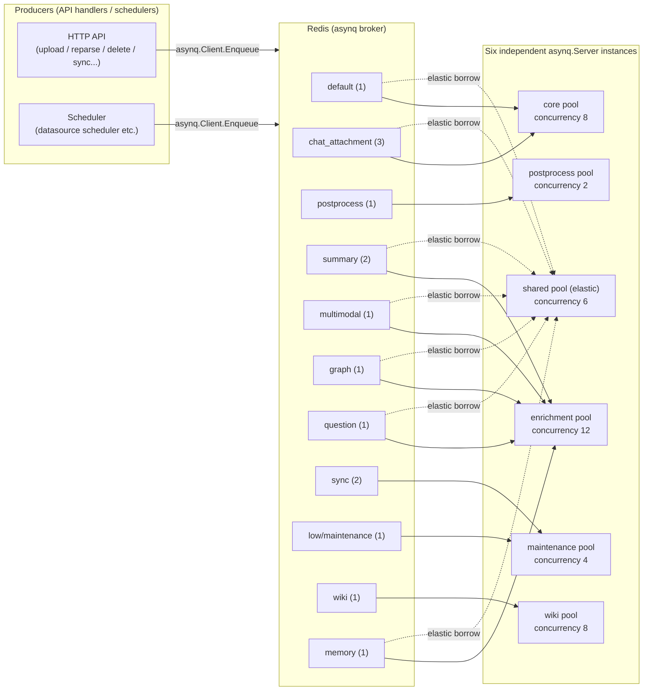

WeKnora's asynchronous task system is the backbone of every time-consuming operation: document parsing, vector indexing, LLM enrichment (summaries, questions, graph extraction), Wiki generation, and data-source sync all run through it. In standard deployments the system uses [Asynq](https://github.com/hibiken/asynq) backed by Redis. In Lite mode, when no Redis is present, a drop-in `SyncTaskExecutor` provides the same task semantics in-process with goroutines.

## Dual Execution Modes

<Tabs>
  <Tab title="Standard (Asynq + Redis)">
    Tasks are serialized as JSON payloads and written to Redis queues by `asynq.Client`. Six independent `asynq.Server` instances (worker pools) consume those queues. The pools, their queues, and their concurrency are all defined in `internal/types/task.go` (`queueDefinitions`), which is the **single source of truth** for both queue topology and the runtime dashboard.

    ```go
    // internal/router/task.go
    const defaultRedisOpTimeoutMs = 500
    opt := &asynq.RedisClientOpt{
        Addr:         os.Getenv("REDIS_ADDR"),
        ReadTimeout:  time.Duration(timeoutMs) * time.Millisecond,
        WriteTimeout: time.Duration(timeoutMs*2) * time.Millisecond,
        // ...
    }
    ```

    Redis connection parameters: `REDIS_ADDR` / `REDIS_USERNAME` / `REDIS_PASSWORD` / `REDIS_DB` / TLS config. Read/write timeouts are controlled by `WEKNORA_REDIS_OP_TIMEOUT_MS` (default 500 ms; write timeout is 2×).
  </Tab>
  <Tab title="Lite Mode (SyncTaskExecutor)">
    When `REDIS_ADDR` is not set, `internal/router/sync_task.go`'s `SyncTaskExecutor` implements the same `interfaces.TaskEnqueuer` interface. `Enqueue` dispatches tasks directly to goroutines.

    ```go
    // internal/router/sync_task.go
    // SyncTaskExecutor executes tasks synchronously (in a goroutine) without Redis.
    // Used in Lite mode as a drop-in replacement for *asynq.Client.
    ```

    The executor honors `ProcessIn` / `ProcessAt` (delayed execution), `MaxRetry`, `Timeout`, and `Deadline` options. Retries use linear backoff (`attempt × 5s`, capped at 30 s). Handler panics are caught and treated as failures without crashing the process. When retries are exhausted, the same dead-letter callback runs as in standard mode—documents are marked `failed`.

    Both modes register exactly the same set of task handlers (`RunAsynqServer` vs. `RegisterSyncHandlers`), ensuring task semantics do not drift between deployment forms.
  </Tab>
</Tabs>

## Startup Migrations

At startup, `initDatabase` (called during DI container assembly) runs `golang-migrate` versioned migrations when `AUTO_MIGRATE=true` (the default):

```yaml
# docker-compose.yml excerpt
- AUTO_MIGRATE=${AUTO_MIGRATE:-true}
```

Migration SQL files live in `migrations/versioned/*.up.sql` (Postgres), `migrations/sqlite/` (Lite), and `migrations/paradedb/`. Migration failure logs a warning but **does not block startup**—allowing rolling upgrades where the new binary starts before all replicas have migrated.

`initDatabase` also handles: backfilling `__pending_env__` storage-provider records, syncing sequences, resetting in-progress tasks in Lite mode, and UPSERT-ing built-in models from `config/builtin_models.yaml`.

## Six Worker Pools



| Pool | Default Concurrency | Queues consumed (weight) | Config env var |
|------|--------------------|--------------------------|----|
| `core` | 8 | `default`(1), `chat_attachment`(3) | `WEKNORA_ASYNQ_CORE_CONCURRENCY` |
| `postprocess` | 2 | `postprocess`(1) | `WEKNORA_ASYNQ_POSTPROCESS_CONCURRENCY` |
| `enrichment` | 12 | `summary`(2), `multimodal`(1), `graph`(1), `question`(1), `memory`(1) | `WEKNORA_ASYNQ_ENRICHMENT_CONCURRENCY` |
| `maintenance` | 4 | `sync`(2), `low`(1) | `WEKNORA_ASYNQ_MAINTENANCE_CONCURRENCY` |
| `shared` (elastic) | 6 | core + enrichment queues with `SharedWeight > 0` | `WEKNORA_ASYNQ_SHARED_CONCURRENCY` |
| `wiki` | 8 | `wiki`(1) | `WEKNORA_WIKI_ASYNQ_CONCURRENCY` |

<Note>
Concurrency is **hard-isolated per pool**, not a weight preference. The `shared` pool subscribes to both core and enrichment queues simultaneously; because Redis dequeuing is atomic, each task is still only executed once.
</Note>

Design rationale for key decisions:

- **`chat_attachment` weight 3 in core**: Interactive chat file uploads get 3× queue priority over bulk KB ingestion in the `default` queue—large imports never starve chat users.
- **`wiki` hard-isolated**: The `wiki` pool only pulls from the `wiki` queue, preventing the parsing pipeline and Wiki generation from starving each other.
- **`postprocess` and `maintenance` excluded from `shared`**: Post-process needs guaranteed latency; maintenance tasks run long and could consume all burst capacity.
- **Queue name stability**: `QueueMaintenance` maps to the physical Redis queue name `"low"` (matching older versions) for rolling-upgrade compatibility.

## Task Type Catalog

All task type constants are defined in `internal/types/task.go`:

| Task type | Queue | Purpose |
|-----------|-------|---------|
| `document:process` | `default` | Document parse entry (DocReader → chunk → embed → index) |
| `manual:process` | `default` | Manual knowledge update (cleanup + re-index) |
| `temporary_document:process` | `chat_attachment` | Chat attachment parsing |
| `knowledge:post_process` | `postprocess` | Post-process orchestrator (fan-out to enrichment sub-tasks) |
| `knowledge:auto_tag` | `summary` | Automatic tag association |
| `summary:generation` | `summary` | Document summary + KB profile generation |
| `kb:profile` | `summary` | Knowledge base description (debounced, 30 s window) |
| `datatable:summary` | `summary` | Spreadsheet table summary |
| `image:multimodal` | `multimodal` | Per-image OCR + VLM Caption |
| `chunk:extract` | `graph` | Entity/relationship extraction into Neo4j |
| `question:generation` | `question` | Question generation (per 20-chunk batch) |
| `memory:extract` | `memory` | Personal memory background extraction |
| `datasource:sync` | `sync` | External data-source sync |
| `faq:import` | `low` (maintenance) | FAQ bulk import (including dry-run) |
| `kb:clone` | `low` | Knowledge base clone |
| `kb:delete` | `low` | Knowledge base deletion |
| `knowledge:list_delete` | `low` | Batch document deletion |
| `knowledge:list_reparse` | `low` | Batch re-parse |
| `knowledge:move` | `low` | Document move between knowledge bases |
| `wiki:ingest` | `wiki` | Wiki page generation/sync |
| `wiki:finalize` | `wiki` | KB-level Wiki finalization (debounced: index rebuild, dead-link cleanup, cross-linking) |

## ServeMux Middleware Chain

`RunAsynqServer` installs four middleware layers on a single shared `asynq.ServeMux` in order:

<Steps>
  <Step title="asynqdl dead-letter middleware (installed first)">
    Must be the outermost middleware so it sees the raw handler error before any other middleware transforms it. On the final retry attempt, writes a row to `task_dead_letters` with the payload, last error (truncated to 8 KB), scope (`knowledge` / `knowledge_base` / `tenant` / `unknown`), and scope ID. Insertion is best-effort; DB failure is logged but does not change the task's error.
  </Step>
  <Step title="asynqdl RecoverMiddleware">
    Converts handler panics into ordinary task errors. Without this, panics bypass the dead-letter callback—leaving documents stuck in `processing` permanently after the final retry.
  </Step>
  <Step title="backgroundTaskMiddleware">
    Tags each task context with `types.WithBackgroundTask`, causing the per-model chat concurrency governor to rate-limit LLM calls from ingestion/enrichment tasks while leaving interactive user chat unaffected.
  </Step>
  <Step title="langfuse.AsynqMiddleware">
    No-op when Langfuse is not configured. When active, continues the upstream HTTP trace (via W3C `traceparent` in the task payload) or opens a new independent trace, wrapping the handler execution in a span named `asynq.<task_type>`.
  </Step>
</Steps>

## Task Lifecycle

```mermaid
stateDiagram-v2
    direction LR
    [*] --> pending : Enqueue()
    [*] --> scheduled : Enqueue(ProcessIn=delay)
    scheduled --> pending : NextProcessAt reached
    pending --> active : Worker atomic dequeue
    active --> completed : Handler returns nil
    active --> retry : Handler returns error\nand retried < max_retry
    retry --> pending : Backoff elapsed\n(default exponential;\nwiki lock conflict: fixed 15s)
    active --> archived : Final retry failed\nasynqdl writes task_dead_letters\n+ callback sets Knowledge=failed
    active --> [*] : CancelProcessing signal\n(context.Canceled)
    pending --> [*] : TaskInspector.DeleteTask\n(cancel / KB delete)
    archived --> pending : Admin action run_now\n(Inspector.RunTask, keeps retry count)
    archived --> [*] : Admin delete / purge archived
    completed --> [*] : Retention TTL expires
```



## Retry Policy

The default retry backoff for most tasks follows Asynq's exponential schedule. Wiki ingest tasks that fail due to a concurrent-lock conflict use a custom 15-second fixed delay:

```go
// internal/router/task.go
func asynqRetryDelayFunc(n int, e error, t *asynq.Task) time.Duration {
    if errors.Is(e, service.ErrWikiIngestConcurrent) {
        return wikiIngestRetryDelay // fixed 15s
    }
    return asynq.DefaultRetryDelayFunc(n, e, t)
}
```

Rationale: orphan lock TTL ≤ 60 s, so a fixed 15 s retry almost always succeeds. Exponential backoff would cause a crash-restarted KB to stall for 7–10 minutes.

## Dead Letter Queue (DLQ)

When all retry attempts are exhausted, a dead-letter row is written to `task_dead_letters`:

```sql
-- query dead letters for a specific knowledge base
SELECT * FROM task_dead_letters
WHERE scope = 'knowledge_base'
  AND scope_id = '<kbID>'
ORDER BY id DESC;
```

The `asynqdl.OnDeadLetter` callback (`newDeadLetterKnowledgeFailer`) performs a conditional update: it sets `parse_status=failed` only when the document is still in an in-progress state (`pending`/`processing`/`finalizing`) and all payload identifiers (tenant, knowledge base, knowledge ID) still match. This prevents the callback from overwriting documents that were cancelled or deleted between retry attempts.

Tasks terminated with `asynq.SkipRetry` do not trigger the dead-letter callback.

## Runtime Dashboard

The task dashboard is accessible at **Settings → Runtime** in the admin UI (System Admin only). It is backed by the `TaskInspector` API:

| Method | Endpoint | Description |
|--------|---------|-------------|
| `GET` | `/api/v1/system/admin/runtime/queues` | Queue depth snapshot + worker heartbeat summary |
| `GET` | `/api/v1/system/admin/runtime/queues/:queue/tasks` | Cursor-paginated task list by status |
| `POST` | `/api/v1/system/admin/runtime/queues/:queue/tasks/:task_id/actions/:action` | `cancel`, `run_now`, or `delete` (writes platform audit log) |
| `DELETE` | `/api/v1/system/admin/runtime/queues/:queue/archived` | Purge all archived tasks in a queue (writes `system.queue_archived_purged` audit entry) |

The dashboard surfaces per-queue metrics:

- **size / pending / active / scheduled / retry / archived / completed** counts
- **`latency_ms`** — age of the oldest pending task (key indicator of backpressure)
- **daily processed / failed** counts
- **Worker heartbeats** — per-pool concurrency, active workers, queue weights, across all replicas

<Tip>
If you see persistent `tasks still queued (backpressure, not stuck)` log entries from the housekeeping service, the bottleneck is queue capacity. Increase the corresponding pool's concurrency rather than investigating for stalls.
</Tip>

Task actions are gated by state: `cancel` applies to `pending`/`active`/`scheduled`/`retry` tasks of cancellable types; `run_now` applies to `scheduled`/`retry`/`archived`; `delete` applies only to `archived` tasks. The task payload displayed in the dashboard is projected to routing metadata only (tenant/KB/knowledge/task/sync IDs)—document content and credentials are never exposed.

## Persistent Task Queue (Wiki)

Alongside Redis queues, `task_pending_ops` is a PostgreSQL-backed persistent queue (no TTL, survives Redis restarts) used primarily by Wiki ingest. Its identity is a `(task_type, scope, scope_id)` triple.

Key behaviors:
- `ClaimBatch` atomically claims entire groups by `dedup_key` (document), ensuring that multiple operations on the same document (e.g., ingest + retract) are never split across concurrent batches
- Claim ordering is `fail_count ASC, enqueued_at ASC`—repeatedly failing documents don't starve newer documents
- `IncrFailCount` with a per-service cap moves entries from `task_pending_ops` to `task_dead_letters` after too many failures
- On startup, `recoverPendingWikiTasks` (invoked via DI `container.Invoke`) requeues any wiki tasks that were in-flight when the process last exited

## Monitoring Checklist

<Accordion title="Runtime API / Dashboard">
  Check queue depth, `latency_ms` (oldest pending age), daily `processed`/`failed`, and worker heartbeats from **Settings → Runtime**. Per-task detail shows `last_error`, `retried/max_retry`, and allows `run_now`/`cancel`/`delete`.
</Accordion>

<Accordion title="Dead Letter Table">
  Query `task_dead_letters` directly by scope, task type, or tenant to aggregate failure rates without log trawling. The `task_pending_ops` table's `PendingCount` and `enqueued_at` reveal never-draining backlog.
</Accordion>

<Accordion title="Logs">
  Worker-side log prefixes: `[TaskInspector]` (cancel/inspect), `asynq dead-letter`, `[SyncTask]` (Lite mode), `[Housekeeping]`. At startup each pool logs: `asynq <pool> server starting with concurrency=...`.
</Accordion>

<Accordion title="Langfuse Tracing">
  When Langfuse is configured, each Asynq task appears as an `asynq.<task_type>` span (with queue, retry count, and payload size metadata), linked to the HTTP request that triggered it via W3C `traceparent` propagation.
</Accordion>
