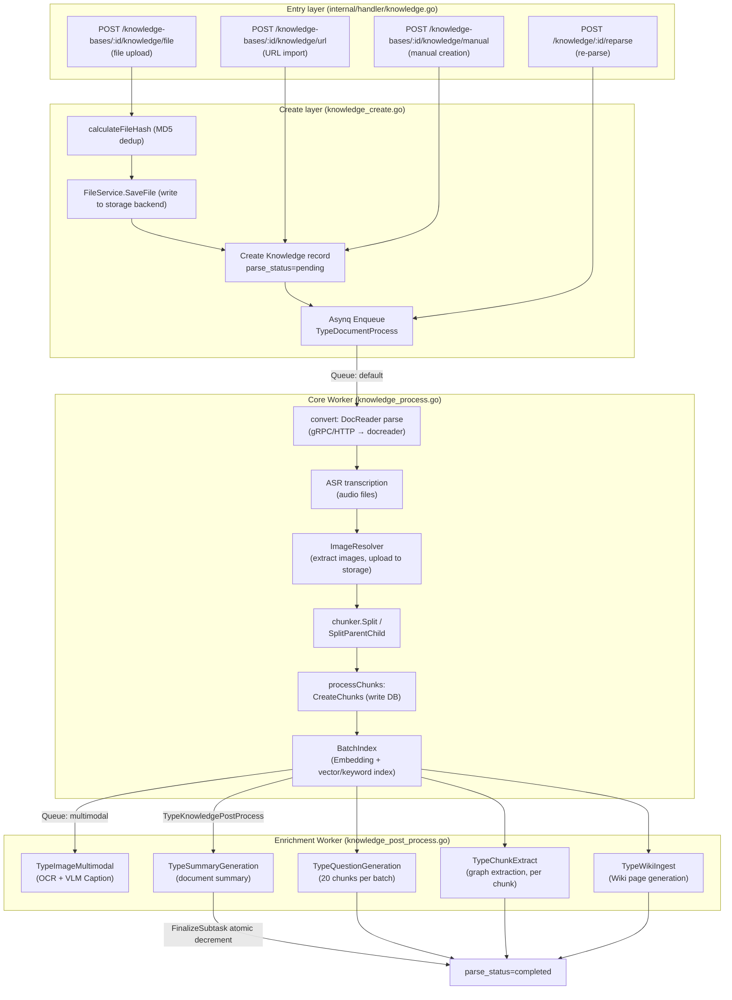
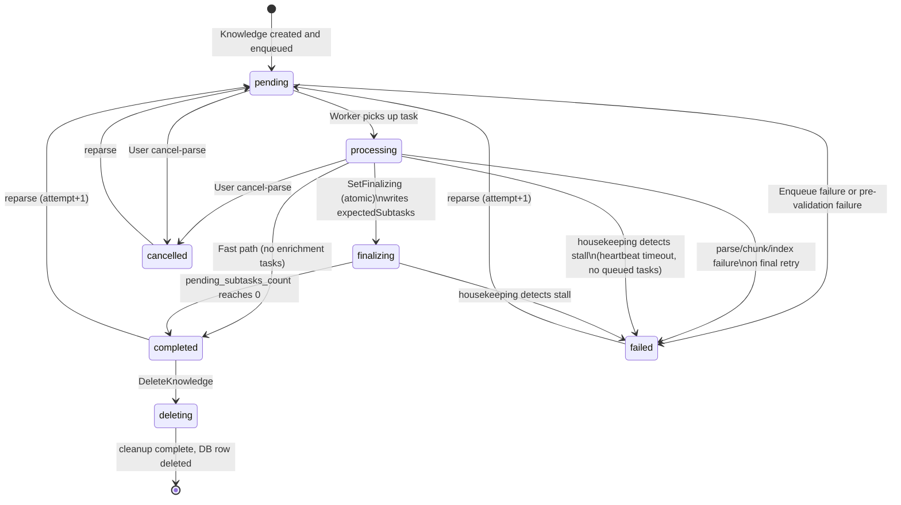

WeKnora's document ingestion pipeline is a **distributed asynchronous pipeline built on Asynq and Redis**. HTTP handlers only persist a record and enqueue a task; all time-consuming work—parsing, embedding, and LLM enrichment—is performed by independent worker pools consuming queue tasks. This separation means a slow PDF parse never blocks the API, and failed documents can be retried without re-uploading.

## Pipeline Overview



## Pipeline Stages

<Steps>
  <Step title="Upload and Deduplication">
    Documents enter through one of three HTTP endpoints—file upload (`POST /knowledge-bases/:id/knowledge/file`), URL import (`POST /knowledge-bases/:id/knowledge/url`), or manual creation (`POST /knowledge-bases/:id/knowledge/manual`).

    File uploads compute an MD5 hash and check for an existing record matching `(type, fileName, fileType, fileSize, fileHash)`. If a duplicate is found, the existing knowledge entry is returned with a `DuplicateFileError`—no redundant re-parsing. Documents with `parse_status = failed` or `deleting` are excluded from dedup checks so they can be re-uploaded.

    The unified extension gate (`supportedImportFileExtensions` in `knowledge_util.go`) covers:
    ```
    pdf txt docx doc epub html htm mhtml md markdown xmind
    png jpg jpeg gif csv xlsx xls pptx ppt json
    mp3 wav m4a flac ogg
    ```

    A new `Knowledge` record is created with `parse_status=pending` and `enable_status=disabled` (not yet searchable), then the `TypeDocumentProcess` task is enqueued to the `default` queue with `MaxRetry(3)` and a `DocumentProcessTimeout` (default 2 hours).
  </Step>

  <Step title="File Storage">
    `FileService.SaveFile` persists the file to the configured storage backend. Object keys follow the pattern `{tenantID}/{knowledgeID}/{uuid or nanosecond timestamp}{ext}`.

    <Accordion title="Supported storage backends">
      | Provider | Path prefix | Notes |
      |----------|------------|-------|
      | `local` | `local://` | Single-machine local disk; `LOCAL_STORAGE_BASE_DIR` configures base path |
      | `minio` | `minio://` | MinIO / S3-compatible; `MINIO_ENDPOINT` + credentials |
      | `cos` | `cos://` | Tencent Cloud COS |
      | `oss` | `oss://` | Alibaba Cloud OSS |
      | `s3` | `s3://` | AWS S3 or compatible |
      | `tos` | `tos://` | Volcengine TOS |
      | `obs` | `obs://` | Huawei Cloud OBS |
      | `ks3` | `ks3://` | Kingsoft Cloud KS3 |
    </Accordion>

    Two wrapper layers sit above the backends: `backend_scoped.go` adds an instance prefix (`storage://{backendID}/{innerPath}`) for multi-backend deployments, and `resource_catalog.go` registers paths as stable `resource://{uuid}` references supporting temporary access grants (`/r/{token}` URLs).
  </Step>

  <Step title="DocReader Parse (Stage: docreader)">
    The core worker calls the **docreader microservice**: a Python gRPC service listening on port `50051` (internal to the compose network). The gRPC service method `ReadStream` sends a first frame with metadata then one frame per image, avoiding gRPC message size limits for large scanned PDFs.

    The parser engine is selected from `eff.ChunkingConfig.ResolveParserEngine(fileType)`:

    | Engine | Transport | Notes |
    |--------|----------|-------|
    | `builtin` | gRPC (`DOCREADER_TRANSPORT=grpc`) or HTTP | Default; calls the Python docreader service |
    | `simple` | Go native | Handles md, txt, csv, json, image, and audio files in-process |
    | `anydoc` | Go native (Rust cgo) | Handles docx/doc/pptx/ppt/xlsx/xls/odf/rtf/epub/csv/pdf in-process using the vendored anydoc Rust library |
    | `mineru` / `mineru_cloud` | HTTP | Self-hosted or cloud MinerU PDF parser (supports MinerU 4.0 V1 API) |
    | `paddleocr_vl` / `paddleocr_vl_cloud` | HTTP | PaddleOCR-VL PDF parser (self-hosted or cloud) |
    | `weknoracloud` | HTTP | WeKnora-hosted managed docreader |

    The docreader service's built-in parsers cover: docx, doc, pdf, md, xlsx, xls, pptx, ppt, epub, html, htm, mhtml, xmind, images, and web pages (via Playwright-based `WebParser`). The `markitdown` (Microsoft MarkItDown) and `opendataloader` (Java-based PDF layout analysis) parsers are also registered.

    All parser outputs are normalized to `ReadResult{MarkdownContent, ImageRefs, Metadata}`. **Parsed output is always Markdown text + image bytes**; image persistence is handled by the Go side.

    For audio files (`IsAudio=true`), an ASR model transcribes `AudioData` and replaces `MarkdownContent` before the pipeline continues.
  </Step>

  <Step title="Image Extraction and Upload">
    `ImageResolver.ResolveAndStore` (`docreader/image_resolver.go`) processes all images in the returned content:

    1. Handles `<!link>`-wrapped images, `data:` URIs, HTML inline base64, and `ImageRefs` bytes from docreader
    2. Filters icon-sized images (width/height < 64px or < 512 bytes)
    3. Uploads to the KB's storage backend via `SaveBytes` with URL deduplication
    4. Rewrites Markdown image references to storage URLs

    A second pass (`ResolveRemoteImages`) downloads and re-hosts any remaining external `http(s)` image URLs, also subject to SSRF validation. The resulting `storedImages []docparser.StoredImage` list is passed to the multimodal enrichment stage.
  </Step>

  <Step title="Chunking (Stage: chunking)">
    Chunking runs in the Go process (`internal/infrastructure/chunker`). The strategy is determined by the effective process config:

    <Tabs>
      <Tab title="Standard Chunking">
        `chunker.Split(markdownContent, chunkCfg)` splits text into `ChunkTypeText` records using the configured chunk size, overlap, and heading-boundary strategy. Each chunk records `StartAt`/`EndAt` rune offsets and a `ContextHeader` (heading breadcrumb) for context-aware embedding.
      </Tab>
      <Tab title="Parent-Child Chunking">
        `chunker.SplitParentChild(content, parentCfg, childCfg)` produces two levels:
        - **Parent chunks** (`ChunkTypeParentText`): larger, linked via `PreChunkID`/`NextChunkID` doubly-linked list; written to DB but **not** indexed in the vector store
        - **Child chunks** (`ChunkTypeText`): smaller, embedded and indexed; carry `ParentChunkID` pointing to their parent

        At query time, child chunks are retrieved by vector/keyword search; then parent chunks are fetched by ID to provide full context to the LLM.
      </Tab>
    </Tabs>

    Inline HTML tables are normalized to Markdown tables (`NormalizeHTMLTables`) before chunking.
  </Step>

  <Step title="Batch Embedding and Indexing (Stage: embedding)">
    `BatchIndex(ctx, embeddingModel, indexInfoList)` embeds all text chunks and writes them to the retrieval engine. The index content is `titlePrefix + chunk.EmbeddingContent()` (heading breadcrumb + body text).

    Parallel indexes are written depending on the KB's `IndexingStrategy`:

    | Index type | Storage | Condition |
    |-----------|---------|-----------|
    | Vector index | pgvector / Qdrant / Milvus / Weaviate / Doris / etc. | `VectorEnabled = true` |
    | BM25 keyword index | ParadeDB (pg_bm25) or Elasticsearch / OpenSearch / Doris | `KeywordEnabled = true` |
    | Wiki page index | PostgreSQL (`wiki_pages` table) | `WikiEnabled = true` |
    | Knowledge graph | Neo4j (via `TypeChunkExtract` enrichment tasks) | `GraphEnabled = true` |

    Once indexing completes, `EnableStatus` is set to `"enabled"` — **the document is immediately searchable**, without waiting for enrichment. If indexing fails, a compensation rollback deletes the already-written chunks and clears the vector index to avoid half-written state.

    Image multimodal tasks are fanned out per image (`TypeImageMultimodal` → `QueueMultimodal`) when `EnableMultimodel` is set.
  </Step>

  <Step title="Enrichment Fan-Out (Stage: postprocess)">
    `TypeKnowledgePostProcess` orchestrates enrichment sub-tasks using an atomic counter. It promotes the document from `processing` to `finalizing` and sets `pending_subtasks_count` to the number of sub-tasks spawned:

    | Sub-task | Queue | Granularity | Purpose |
    |----------|-------|-------------|---------|
    | `TypeSummaryGeneration` | `summary` | 1 per document | Generates a document summary (`summary_status` state machine) |
    | `TypeQuestionGeneration` | `question` | 1 per 20-chunk batch | Generates retrieval questions per chunk |
    | `TypeChunkExtract` | `graph` | 1 per chunk | Entity/relationship extraction into Neo4j |
    | `TypeWikiIngest` | `wiki` | Debounced batch | Generates/updates Wiki pages |
    | `TypeImageMultimodal` | `multimodal` | 1 per image | OCR + VLM Caption per extracted image |

    Each sub-task calls `FinalizeSubtask` upon completion, which atomically decrements `pending_subtasks_count`. When it reaches zero, `parse_status` is automatically promoted to `completed`.

    <Note>
    `FinalizeSubtask` executes with `context.WithoutCancel` + a 10-second timeout so that graceful worker shutdown cannot prevent the counter from being decremented—which would leave documents permanently stuck in `finalizing`.
    </Note>
  </Step>

  <Step title="Image Multimodal Enrichment">
    `ImageMultimodalService.Handle` processes each image individually:

    1. Reads image bytes from storage or URL
    2. Generates a **Caption** (VLM model with `buildVLMCaptionPrompt`) and **OCR text**
    3. Creates two child chunks: `ChunkTypeImageCaption` and `ChunkTypeImageOCR`, each with `ParentChunkID` pointing to the owning text chunk, and separately indexed in the vector store
    4. If the KB has image vectors enabled (`ImageProcessingConfig.ImageVectorEnabled`) and the embedding model supports images, creates a third child chunk `ChunkTypeImageVector` using the image bytes directly for embedding

    This enables queries like "find a diagram showing X" to match on image content, not just surrounding text.
  </Step>
</Steps>

## Document Status Machine

The `Knowledge.ParseStatus` field tracks seven states:



## Processing Timeline (Span Tracker)

Each round of processing has an independent `Attempt` number, and each of the five canonical stages (`docreader`, `chunking`, `embedding`, `multimodal`, `postprocess`) records a span with `pending`, `running`, `done`, `failed`, `skipped`, or `cancelled` status. The frontend renders these as a timeline.

Each span records key metrics in its `JSONMap`: `chunks_planned`, `chunks_written`, `total_text_chars`, and so on. Every span update also refreshes a heartbeat timestamp (`touchKnowledgeHeartbeat`) used by the housekeeping service to distinguish actively-processing documents from stalled ones.

## Housekeeping and Self-Healing

A background cron job runs every 5 minutes (`WEKNORA_HOUSEKEEPING_ENABLED`, default enabled) and applies three sweeps:

<Accordion title="Sweep A — Stalled document recovery">
  Three-stage filter: first a coarse database scan for documents in `pending`/`processing`/`finalizing` whose `updated_at` exceeds `staleThreshold = max(1h, DocumentProcessTimeout) + 10min`; then a heartbeat check against `knowledge_processing_spans`; then an Asynq queue probe to exclude documents that are just backpressure-queued, not stuck.

  Stalled documents are set to `parse_status=failed` with an `error_message` like:
  ```
  task stuck in processing at docreader stage: no progress since 2026-09-22T09:37:54Z (> 2h10m0s), recovered by housekeeping
  ```
  Span records for the stalled attempt are closed with `TASK_STALLED` error codes.
</Accordion>

<Accordion title="Sweep B — Summary stall recovery">
  Documents with `summary_status=processing` older than 1 hour are reset to `failed`. Documents stuck with `summary_status=pending` after parsing has finished (> 1 hour, no queue entry) are also reset.
</Accordion>

<Accordion title="Sweep C — Deletion stall recovery">
  Documents in `parse_status=deleting` beyond the stale threshold with no active `knowledge:list_delete` queue task are reset to `failed` and become visible again in the UI, allowing re-deletion.
</Accordion>

## Retry Behavior and Dead Letters

The `TypeDocumentProcess` task uses `MaxRetry(3)` (up to 4 total attempts). The processing function distinguishes between the last and non-last retry: non-last retries return the error to Asynq for re-queuing; only on the final retry is `ParseStatus` set to `failed` and `ErrorMessage` written.

When all retries are exhausted, the `asynqdl` dead-letter middleware writes a row to `task_dead_letters` with the original payload (for future replay), the last error (truncated to 8 KB), and a `scope`/`scope_id` derived from the payload. The dead-letter callback (`newDeadLetterKnowledgeFailer`) conditionally sets `parse_status=failed` only when the document is still in an in-progress state and payload identifiers match—it will never overwrite a document that was already cancelled or deleted.

<Warning>
Re-parsing (`POST /knowledge/:id/reparse`) increments the `Attempt` counter and cancels any in-flight tasks from the previous attempt. Tasks from an old attempt detect the superseded attempt number and exit silently without writing to the database.
</Warning>

## Supported File Formats

The docreader Python service registers parsers for 25+ formats:

| Category | Formats |
|----------|---------|
| Documents | PDF, DOCX, DOC, EPUB, RTF, ODF, PPTX, PPT |
| Spreadsheets | XLSX, XLS, CSV |
| Web / Markup | HTML, HTM, MHTML, Markdown, JSON |
| Mind Maps | XMind |
| Images | PNG, JPG, JPEG, GIF |
| Audio | MP3, WAV, M4A, FLAC, OGG (via ASR model) |
| Web pages | Any HTTP/HTTPS URL (Playwright-based `WebParser`) |

Video files are explicitly rejected with a clear user-facing error message.
