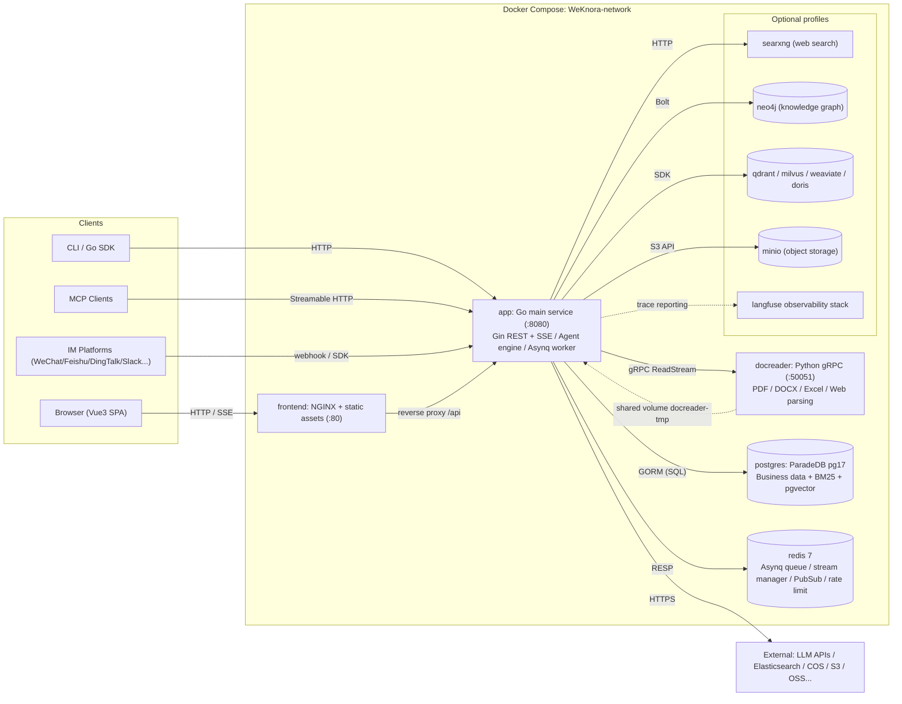

WeKnora follows a **three-process core architecture**: a Go main service that handles REST APIs, RAG retrieval, the Agent engine, and async task workers; a Vue 3 + NGINX frontend that doubles as a reverse proxy; and a Python gRPC document-parsing microservice. PostgreSQL (ParadeDB) and Redis are the two mandatory infrastructure dependencies. Everything else—vector stores, knowledge graphs, object storage, and observability tooling—is optional and enabled through Docker Compose profiles.

## System Components

### Core Services (always started)

| Service | Image / Build | Port | Responsibility |
|---------|--------------|------|----------------|
| `app` | `wechatopenai/weknora-app` (Go, `docker/Dockerfile.app`) | `8080` | Main backend: REST API, RAG retrieval, Agent engine, async task workers, IM/Embed channel ingestion. Health check: `GET /health` |
| `frontend` | `wechatopenai/weknora-ui` (NGINX + Vue 3 static assets) | `80` | Web UI; NGINX simultaneously acts as a reverse proxy, forwarding `/api` to `app` (configurable via `APP_HOST` / `APP_BACKEND_PORT` / `APP_SCHEME`) |
| `docreader` | `wechatopenai/weknora-docreader` (Python, `docker/Dockerfile.docreader`) | `50051` (compose network only, not published to host) | Document parsing microservice: gRPC server handling PDF, DOCX, Excel, EPUB, web pages, and 25+ other formats. Health check: `grpc_health_probe` |
| `postgres` | `paradedb/paradedb:v0.25.11-pg17` | `5432` (network only) | Primary database. ParadeDB includes BM25 full-text search and pgvector, so **no separate vector store is required** by default (`RETRIEVE_DRIVER=postgres`) |
| `redis` | `redis:7.0-alpine` (`appendonly` + `requirepass`) | `6379` (network only) | Asynq task queue, SSE stream management across instances, `system_settings` pub/sub, rate limiting, and distributed per-model concurrency gates |
| `sandbox` | `wechatopenai/weknora-sandbox` | — | Standard execution image; used directly for space Docker backend or registered as a template via the CubeSandbox/E2B control plane |

<Note>
`app` and `docreader` share the `docreader-tmp` volume (mounted at `/tmp/docreader`) to transfer parsed images from the Python service to Go. The `app` container's local file storage volume is `data-files` (at `/data/files`).
</Note>

### Optional Components (Docker Compose Profiles)

| Service | Profile | Purpose |
|---------|---------|---------|
| `searxng` (+ one-shot `searxng-init`) | `searxng` / `full` | Self-hosted meta-search engine for Agent web search (default bind: `127.0.0.1:8888`) |
| `neo4j` | `neo4j` / `full` | Knowledge graph storage (GraphRAG), enabled by `NEO4J_ENABLE`, Bolt on port `7687` |
| `minio` | `minio` / `full` | Object storage (`STORAGE_TYPE=minio`) |
| `qdrant` / `milvus` / `weaviate` | Each respective profile | Standalone vector stores (switched via `RETRIEVE_DRIVER`) |
| `doris-fe` + `doris-be` | `doris` | Apache Doris 4.1 retrieval engine (FE MySQL 9030 / FE HTTP 8030 / BE 8040) |
| `odl-hybrid` | `odl-hybrid` | OpenDataLoader PDF hybrid parsing backend (docreader calls it over HTTP `:5002`) |
| `dex` | `dex` / `full` | OIDC test IdP (for `OIDC_AUTH_ENABLE`) |
| `langfuse-*` (web/worker/clickhouse/minio/db-init) | `langfuse` | Self-hosted LLM observability stack, reusing WeKnora's postgres (new `langfuse` database) and redis (DB 1) |

The Go backend can also connect directly to external engines not listed in compose: Elasticsearch v7/v8, OpenSearch, Tencent Cloud VectorDB, and 8 object storage providers (local / MinIO / COS / TOS / S3 / OSS / KS3 / OBS).

## Deployment Modes

<CardGroup cols={2}>
  <Card title="Standard" icon="docker">
    Full Docker Compose deployment with all core services plus optional profile components. Redis and PostgreSQL are required. Recommended for production.
  </Card>
  <Card title="Lite" icon="feather">
    `DB_DRIVER=sqlite` (with the built-in `sqlite-vec` vector extension) and no `REDIS_ADDR`. Asynq degrades to an in-process `SyncTaskExecutor`. The Go binary serves frontend static assets directly when `handler.Edition == "lite"`.
  </Card>
  <Card title="Desktop" icon="desktop">
    `cmd/desktop` packages the application as a desktop app using Wails v2. Sessions run in a local OS sandbox (currently macOS, via Seatbelt).
  </Card>
  <Card title="Kubernetes" icon="cloud">
    A Helm chart lives under `helm/` with `Chart.yaml`, `values.yaml`, and templates. For bare-metal deployments, systemd unit files are in `deploy/`.
  </Card>
</CardGroup>

## Tech Stack

| Layer | Technology | Version / Notes |
|-------|-----------|----------------|
| Backend language | Go | `go 1.26.0` (declared in `go.mod`) |
| Web framework | `github.com/gin-gonic/gin` | v1.12.0 |
| ORM | `gorm.io/gorm` + postgres/sqlite drivers | v1.31.1; SQLite includes `sqlite-vec` vector extension |
| Dependency injection | `go.uber.org/dig` | v1.19.0 (constructor injection; no code generation) |
| Async task queue | `github.com/hibiken/asynq` | v0.26.0 (Redis-backed, 6 worker pools) |
| Cache / queue broker | `github.com/redis/go-redis/v9` | v9.14.1 |
| Authentication | `github.com/golang-jwt/jwt/v5` + OIDC | JWT Bearer / X-API-Key / OIDC |
| Database migrations | `github.com/golang-migrate/migrate/v4` | `migrations/versioned/*.up.sql`; run at startup via `AUTO_MIGRATE` |
| Logging | `github.com/sirupsen/logrus` + lumberjack rotation | Custom formatter; `request_id` propagated throughout |
| Configuration | `github.com/spf13/viper` + `config/config.yaml` + env vars | — |
| Observability | OpenTelemetry + Langfuse (`internal/tracing/langfuse`) | LLM call-level tracing |
| gRPC | `google.golang.org/grpc` | v1.81.0 (calls docreader) |
| Vector / retrieval | pgvector, ES v7/v8, OpenSearch, Qdrant, Milvus, Weaviate, Doris, Tencent VectorDB, sqlite-vec | Driven by `RETRIEVE_DRIVER` and `vector_stores` table |
| Knowledge graph | `neo4j/neo4j-go-driver/v6` | Optional |
| Concurrency pool | `panjf2000/ants/v2` | Document processing goroutine pool (`CONCURRENCY_POOL_SIZE`) |
| MCP | `mark3labs/mcp-go` | v0.52.0 (external MCP tools including OAuth) |
| Frontend framework | Vue 3 (^3.5) + TypeScript + Vite 7 | `frontend/package.json` |
| Frontend UI | TDesign Vue Next, Pinia, Vue Router 4, vue-i18n | Marked / KaTeX / Mermaid / highlight.js for rich-text rendering |
| Document parsing | Python + grpcio | `docreader/main.py`; parsers in `docreader/parser/` |
| Desktop | Wails v2 | `cmd/desktop` |

## Inter-Process Communication

| Link | Protocol | Notes |
|------|---------|-------|
| Browser → `frontend` (NGINX) → `app` | HTTP/HTTPS (REST + SSE) | NGINX reverse-proxies `/api`; chat responses use SSE streaming |
| `app` → `docreader` | **gRPC** (default `docreader:50051`, `DOCREADER_TRANSPORT=grpc`; TLS/mTLS supported) | Proto definitions in `docreader/proto/`; large files use streaming `ReadStream` |
| `app` → `postgres` | PostgreSQL wire (GORM/pgx) | Business data + BM25 + pgvector |
| `app` ↔ `redis` | RESP (TLS supported) | ① Asynq task queue; ② SSE stream manager; ③ `system_settings` pub/sub; ④ Embed channel rate limiting; ⑤ distributed per-model concurrency semaphore |
| `app` → `neo4j` | Bolt (`bolt://neo4j:7687`) | GraphRAG entity/relationship storage |

## Architecture Diagram

## Repository Top-Level Directory Guide

| Directory | Responsibility |
|-----------|---------------|
| `cmd/` | Entry points: `cmd/server` (main service), `cmd/desktop` (Wails desktop), `cmd/download` (model/resource download helper) |
| `internal/` | All Go backend business code: `handler`, `application/service`, `application/repository`, `container` (DI), `router`, `middleware`, `types`, `agent`, `im`, `mcp`, `stream`, `sandbox` |
| `frontend/` | Vue 3 + Vite + TDesign web frontend; build artifacts served by NGINX or embedded in Lite mode |
| `docreader/` | Python gRPC document-parsing microservice: `main.py` server, `parser/` (25+ parsers), `splitter/`, `proto/` |
| `cli/` | `weknora` command-line tool: knowledge bases, documents, retrieval, sessions, agents, models, MCP, skills |
| `client/` | Go SDK: HTTP client wrapping the WeKnora API |
| `migrations/` | golang-migrate database migrations: `versioned/` (Postgres), `sqlite/` (Lite), `paradedb/`, `mysql/` |
| `config/` | Runtime configuration: `config.yaml`, `builtin_agents.yaml`, `agent_type_presets.yaml`, `prompt_templates/` |
| `helm/` | Kubernetes Helm Chart (`Chart.yaml` / `values.yaml` / `templates/`) |
| `deploy/` | Bare-metal deployment resources (systemd service units) |
