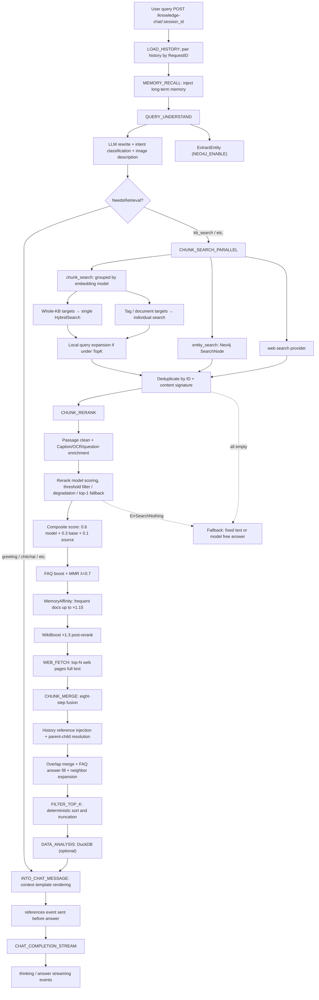
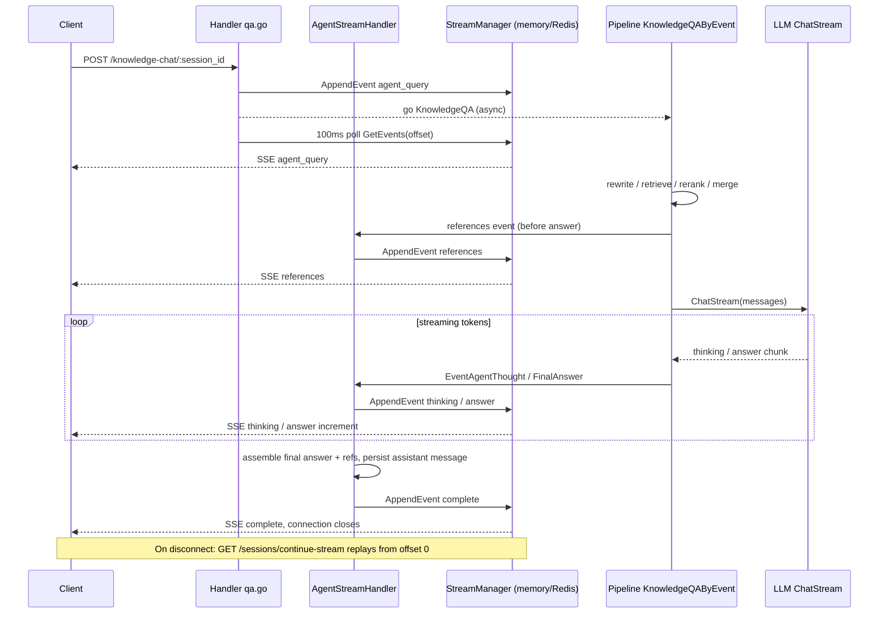

WeKnora's retrieval-augmented generation (RAG) pipeline is an **event-driven plugin pipeline**: each processing stage is a plugin implementing a `Plugin` interface, registered on an `EventManager`. An orchestrator triggers events in a dynamically assembled sequence, with plugins chained via a responsibility chain (`next()`). Generation output doesn't write directly to HTTP responses—instead it publishes events through a per-request `EventBus` into a shared `StreamManager` (in-memory or Redis), which the HTTP layer polls every 100 ms to push SSE events to clients. This design naturally supports **disconnect-reconnect resume** and **multi-replica distributed deployment**.

## Pipeline at a Glance



## Retrieve Endpoint

The retrieval pipeline is invoked via the knowledge-base retrieve endpoint used by the chat handlers:

```
GET /api/v1/knowledge-bases/:id/retrieve
```

The shared search logic is implemented in `internal/application/service/knowledgebase_search.go` and is used by the chat pipeline, Agent tools, and the public search API.

## Stage-by-Stage Breakdown

<Steps>
  <Step title="LOAD_HISTORY">
    Fetches recent messages for the session using `messageService.GetRecentMessagesBySession`, pairs `user`/`assistant` turns by `RequestID` into `types.History` structs, strips think-tags from assistant messages, and writes the ordered history into `chatManage.History`. Skipped when `MaxRounds <= 0` (Agent multi-turn explicitly disabled).
  </Step>

  <Step title="MEMORY_RECALL">
    When long-term memory is enabled for the space, this stage recalls the caller's personal memory entries based on the current query and injects them as `chatManage.MemoryPrompt`. Emits a `memory_recalled` event so the UI can surface which memories were used. Does not invoke a model; failure does not block the pipeline.
  </Step>

  <Step title="QUERY_UNDERSTAND">
    Two plugins run in a responsibility chain on the same event:

    **PluginQueryUnderstand** rewrites the query and classifies intent. It calls the LLM with a template from `config/prompt_templates/rewrite.yaml` (overridable at the Agent level) and expects JSON output: `{"rewrite_query":"...","intent":"kb_search","image_description":"..."}`. Intent values include `kb_search`, `web_search`, `greeting`, `chitchat`, `follow_up`, `image_only`, `doc_only`, `summarize`, and `clarification`. Non-retrieval intents trigger intent-specific system prompt overrides from `config/prompt_templates/intent_prompts.yaml`.

    **PluginExtractEntity** (inner chain) runs only when `NEO4J_ENABLE=true` and the query targets a knowledge base with graph extraction enabled. It calls the LLM using the `graph_extraction.yaml` template to extract query entities into `chatManage.Entity` for the graph search stage.
  </Step>

  <Step title="CHUNK_SEARCH_PARALLEL">
    Runs two searches concurrently using `Clone()`-ed `ChatManage` copies:

    - **chunk_search** (PluginSearch): Groups `SearchTargets` by embedding model identity (`model.Name + BaseURL`). Whole-KB targets without tag/document constraints are merged into a **single** `HybridSearch` call. Targets with constraints are searched individually. Web search runs in parallel when `WebSearchEnabled` is set.
    - **entity_search** (PluginSearchEntity): When graph entities were extracted, searches Neo4j by `NameSpace{KnowledgeBase, Knowledge}` in parallel, converts hits to `SearchResult`, and assembles a `GraphResult`.

    If initial recall is below `EmbeddingTopK`, **local query expansion** (`query_expansion.go`) generates keyword variants (stopword removal, word-order permutation, key-phrase extraction) and runs additional keyword-only `HybridSearch` calls—no extra embedding calls.

    Results from both paths are deduplicated by chunk ID and content signature.
  </Step>

  <Step title="CHUNK_RERANK">
    PluginRerank (720 lines) runs four sub-steps:

    1. **Passage cleaning** — strips Markdown fences, HTML tags, image references, table separators, and heading/bold markers while keeping code and formula content.
    2. **Passage enrichment** — appends image Caption/OCR text and AI-generated questions from `ChunkMetadata`.
    3. **Rerank model scoring** — calls `rerankModel.Rerank(ctx, RewriteQuery, passages)` and applies `RerankThreshold`. If all scores fall below threshold but top-1 ≥ `rerankFallbackMinScore` (default 0.15), top-1 is kept as a fallback. If threshold > 0.3 and nothing passes, the threshold is degraded by ×0.7 and retried once. Model failure falls back to raw retrieval scores.
    4. **Composite scoring** — `0.6 × model_score + 0.3 × base_score + 0.1 × source_weight`, clamped to [0,1].

    After scoring, **FAQ boost** multiplies FAQ chunk scores by `FAQScoreBoost` (when > 1.0) without capping at 1.0. **MMR** (`SelectMMR`, λ=0.7, k=`RerankTopK`) diversifies results using inverted-index Jaccard redundancy. **MemoryAffinity** (innermost chain) weights frequently-cited documents logarithmically, up to ×1.15. **WikiBoost** (post-`next()`) multiplies wiki-page-type chunks by ×1.3 after reranking completes.
  </Step>

  <Step title="WEB_FETCH (conditional)">
    When `WebFetchEnabled && WebSearchEnabled`, fetches full text for the top `WebFetchTopN` (default 3) web results in parallel via `web_fetch.FetchURLContent`, replacing the snippet with up to 8,000 bytes of content. Positioned after reranking so fetching cost is only paid for high-scoring web hits.
  </Step>

  <Step title="CHUNK_MERGE">
    Eight fusion steps applied to `RerankResult` (falls back to `SearchResult` if empty):

    1. Deduplicate by ID + content signature
    2. Inject history references (up to 3, scored at 0.6×, filtered by query-term overlap ≥ 0.3)
    3. Resolve parent-child chunks — sub-chunks (text, image_ocr, image_caption, image_vector) pull in their `parent_text` content
    4. Group by `KnowledgeID + ChunkType`, sort by `ChunkIndex`, and merge sequential chunks (adjacent or content-contained)
    5. Fill FAQ answer text from `FAQMetadata`
    6. Expand short chunks (< 350 chars) by fetching `PreChunkID`/`NextChunkID` neighbors up to ~850 chars
    7. Second deduplication pass after expansion
    8. Remove partial overlaps: chunks with token overlap ratio ≥ 0.85 collapse to the higher-scoring one
  </Step>

  <Step title="FILTER_TOP_K">
    Deterministically sorts `MergeResult` in descending score order, using `KnowledgeID` / `ChunkType` / `ChunkIndex` / `ID` as stable tie-breakers (to counteract map-iteration ordering from the merge stage), then truncates to `RerankTopK`. Results kept by image-vector fallback (`kept_by` tag) are appended after the cutoff without consuming quota.
  </Step>

  <Step title="DATA_ANALYSIS (optional)">
    When `DataAnalysisEnabled` (Agent configuration) and the merged results contain a CSV/Excel file, loads the file into DuckDB, asks the LLM whether data analysis is needed and to produce a DuckDB SQL query, executes it, and appends the result as a synthetic `SearchResult` with score 1.0.
  </Step>

  <Step title="INTO_CHAT_MESSAGE">
    Assembles the final user message for the LLM. Renders the `ContextTemplate` from `config/prompt_templates/context_template.yaml`, wrapping each result as `<context id="N">`. FAQ-priority mode splits results into `source type="faq" priority="high"` and `source type="document" priority="supplementary"` sections. Images from image-vector hits are read and appended to the message payload (up to 3, for vision-capable models). The assembled `UserContent` is written back to the user message's `RenderedContent` asynchronously.
  </Step>

  <Step title="CHAT_COMPLETION_STREAM">
    Calls `chatModel.ChatStream` and starts a goroutine consuming the response channel. `ResponseTypeThinking` tokens are emitted as `EventAgentThought`; `ResponseTypeAnswer` tokens as `EventAgentFinalAnswer`. A `modelcontext.StreamDecoder` restores resource handle aliases (`res://`) and expands inline citation `ref` tags as the stream passes through. Truncation (`finish_reason == "length"`) sets `truncated: true` on the answer event.
  </Step>
</Steps>

## Hybrid Search

WeKnora's default retrieval driver (`RETRIEVE_DRIVER=postgres`) uses ParadeDB which bundles both **pgvector** (vector similarity) and **BM25 full-text search** in a single PostgreSQL instance. No separate vector database is required.

For each retrieval group, the fusion layer uses **weighted Reciprocal Rank Fusion (RRF)**:

```
score = vectorWeight / (k + vectorRank) + keywordWeight / (k + keywordRank)
```

The result is normalized to [0,1] by dividing by the theoretical maximum `(vectorWeight + keywordWeight) / (k + 1)`. Weights and `k` come from the tenant's `RetrievalConfig`. This produces scores on a common scale across multiple retrieval calls, enabling stable multi-store merging.

<Tabs>
  <Tab title="Standard">
    Text chunks are embedded and stored in the vector index alongside a BM25 keyword index. Queries hit both indexes; results are fused with RRF before reranking.
  </Tab>
  <Tab title="Parent-Child Chunking">
    Documents are split into small child chunks (for embedding precision) and large parent chunks (for context richness). Only child chunks enter the vector index; when a child chunk is retrieved, its parent text is fetched and used as the LLM context. Configured per knowledge base via `ChunkingConfig.EnableParentChild`.
  </Tab>
  <Tab title="GraphRAG (Neo4j)">
    When `NEO4J_ENABLE=true`, extracted entities and relationships are stored in Neo4j. At query time, `PluginExtractEntity` extracts query entities and `PluginSearchEntity` retrieves related graph nodes in parallel with vector search. Graph hits are merged with text hits before reranking. Graph chunks carry no retrieval score; the reranker's model score fills in.
  </Tab>
</Tabs>

## Retrieval Strategies

<Accordion title="FAQ Knowledge Base Retrieval">
  FAQ knowledge bases use a dedicated index mode. Depending on `FAQIndexMode`, questions are indexed as `question_only` (standard question text only) or `question_answer` (question + answer combined). Individual similar questions can be indexed separately (`FAQQuestionIndexModeSeparate`) to increase recall surface area.

  **Iterative retrieval**: When the initial result set is below `MatchCount` and a vector result list is saturated, up to 5 rounds of doubling TopK are attempted, fusing results the same way each time.

  **Negative-question filtering**: If a query matches a FAQ entry's `NegativeQuestions` list (exact, lowercased), that entry is excluded—enabling operators to configure "do not answer this FAQ for this exact question" behavior.
</Accordion>

<Accordion title="Multi-Store Fan-Out">
  When multiple vector stores are configured (via the `vector_stores` table), retrieval fans out concurrently across store groups with `errgroup`, each with a configurable timeout (`MULTI_STORE_RETRIEVE_TIMEOUT_SEC`, default 30 s). An `EngineAwareNormalizer` maps vector scores from each engine type to a common [0,1] scale before RRF fusion.
</Accordion>

## Reranking

<Note>
Reranking is the most expensive step in the pipeline. It submits up to 200 enriched passages to the rerank model in a single call. The cross-encoder model processes (query, passage) pairs and returns relevance scores that are then combined with retrieval base scores via the composite scoring formula.
</Note>

Supported reranker configurations:

| Vendor type | Notes |
|-------------|-------|
| Cross-encoder (generic) | Any model exposing the rerank API; configured as `type: Rerank` in the Models settings |
| Vision-capable reranker | Models with `input: [image]` capability (e.g., `jina-reranker-m0`, `nvidia/llama-nemotron-rerank-vl-1b-v2`) can score image-vector chunks using the actual image bytes instead of OCR text |
| Ollama | Local cross-encoder models via `OLLAMA_BASE_URL` |

When the rerank model is unavailable (deleted, credentials invalid, API timeout after 60 s), the pipeline falls back gracefully to using raw retrieval scores.

## Citation Generation

Each request gets an isolated `modelcontext.Registry` instance that assigns low-entropy aliases to sources: `cN` for knowledge chunks, `wN` for web pages, `dN` for documents, `bN` for knowledge bases. The registry generates a `ProtocolPrompt()` appended to the system prompt instructing the model to use self-closing `<ref id="cN"/>` inline citation tags.

The streaming `StreamDecoder` restores resource handle aliases (`res://0001` → actual storage URI) and expands `ref` tags into public `<kb chunk_id="..." knowledge_id="...">` or `<web url="..." title="...">` tags that the frontend renders as superscript citations.

Regardless of inline citation settings, the `MergeResult` is always pushed as a `references` SSE event before the answer begins—so the "Retrieved Sources" panel is always populated.

## Streaming and Reconnect



The `StreamManager` is append-only. `GetEvents(sessionID, messageID, fromOffset)` returns events from the given offset, enabling any node to replay from the beginning at any time.

<Tip>
To continue a disconnected stream, call `GET /api/v1/sessions/continue-stream/:session_id?message_id=...`. The server replays all stored events from offset 0, coalescing consecutive answer increments into single frames before resuming live polling.
</Tip>

## SSE Event Types

| `response_type` | Meaning |
|----------------|---------|
| `agent_query` | Query accepted; carries `session_id` and `assistant_message_id` |
| `thinking` | Incremental reasoning content (for thinking models) |
| `answer` | Incremental answer text; `data.truncated: true` when cut by model token limit |
| `references` | Knowledge reference list (`knowledge_references` field) |
| `tool_call` / `tool_result` | Agent/progress tool invocations (RAG pipeline progress surfaces here too) |
| `session_title` | Asynchronously generated session title |
| `error` | Whole-round execution failure |
| `complete` | Stream end marker |
