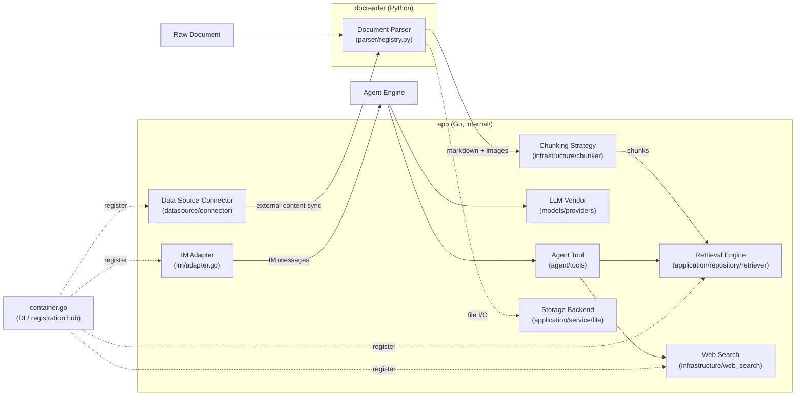

WeKnora is designed around explicit extension points: every major subsystem exposes a Go interface or Python base class, and a central registration entry ties implementations into the dependency graph at startup. Parsers, chunking strategies, retrieval engines, LLM vendors, web search providers, data source connectors, IM adapters, agent tools, and storage backends can all be swapped or extended without touching core logic.

The diagram below shows how the pieces fit together:



On the Go side, most registration happens in `internal/container/container.go`: `initRetrieveEngineRegistry()`, `registerWebSearchProviders()`, `registerIMAdapterFactories()`, and `initConnectorRegistry()`.

---

## Extension Point Details

<Accordion title="1 — Document Parser (Python, docreader/)">

### Interface

The base class lives in `docreader/parser/base_parser.py`. After a lightweight refactor, `BaseParser` is responsible only for converting raw bytes into Markdown text plus image references; chunking, image storage, OCR, and VLM captioning happen in the Go layer.

```python
# docreader/parser/base_parser.py
class BaseParser(ABC):
    """Base parser interface."""

    def __init__(self, file_name: str = "", file_type: Optional[str] = None, **kwargs):
        self.file_name = file_name
        self.file_type = file_type or os.path.splitext(file_name)[1].lstrip(".")

    @abstractmethod
    def parse_into_text(self, content: bytes) -> Document:
        """Parse document content into markdown text.

        Returns:
            Document with ``content`` (markdown string) and optional
            ``images`` dict mapping storage-relative paths to base64 data.
        """
```

`Document` (`docreader/models/document.py`, a pydantic model) has two core fields: `content: str` (Markdown) and `images: Dict[str, str]` (path → base64).

### Registration

`docreader/parser/registry.py` manages a two-level map of `engine_name → {file_extension → Parser class}`. When the requested engine does not support a given file type, it falls back to the `builtin` engine. The module-level singleton is built by `_build_default_registry()`.

```python
# docreader/parser/registry.py (excerpt)
class ParserEngineRegistry:
    def register(self, name: str, file_types: Dict[str, Type[BaseParser]],
                 description: str = "", check_available: Callable = None,
                 unavailable_hint: str = ""): ...
    def get_parser_class(self, engine: str, file_type: str) -> Type[BaseParser]: ...
```

### Existing implementations

| Engine | Parsers | Location |
|--------|---------|----------|
| `builtin` | `Docx2Parser`, `DocParser`, `PDFParser`, `MarkdownParser`, `ExcelParser`, `EPUBParser`, `HTMLParser`, `MHTMLParser`, `ImageParser` | `docreader/parser/*.py` |
| `markitdown` | `MarkitdownParser` (Microsoft MarkItDown, multi-format) | `docreader/parser/markitdown_parser.py` |
| `opendataloader` | `OpenDataLoaderParser` (PDF layout analysis, requires Java 11+) | `docreader/parser/opendataloader_parser.py` |

### Adding a new parser

1. Create `docreader/parser/my_parser.py` inheriting `BaseParser`, implementing `parse_into_text(content: bytes) -> Document`.
2. **Register** in `docreader/parser/registry.py` inside `_build_default_registry()`:

```python
reg.register(
    "my_engine",
    {"myext": MyParser},
    description="My custom parser",
    check_available=lambda overrides: (True, ""),   # optional dependency probe
    unavailable_hint="Missing dependency hint",      # optional
)
```

3. To swap an existing extension's implementation, add `"ext": MyParser` to the `builtin` mapping instead.
4. Add a `unittest` in `docreader/tests/` (see `test_parser_routing.py` for reference) and verify with `uv run python -m unittest`.

</Accordion>

<Accordion title="2 — Chunking Strategy (Go, internal/infrastructure/chunker)">

### Interface

Chunking does not use a traditional interface. Instead, it uses a **strategy tier + package-level function variable override** pattern. The public entry point is `internal/infrastructure/chunker/strategy.go`:

```go
// internal/infrastructure/chunker/strategy.go
const (
    StrategyAuto      = "auto"
    StrategyHeading   = "heading"
    StrategyHeuristic = "heuristic"
    StrategyRecursive = "recursive"
    StrategyLegacy    = "legacy"
)

func Split(text string, cfg SplitterConfig) []Chunk
func SplitWithDiagnostics(text string, cfg SplitterConfig) ([]Chunk, *Diagnostics)
func SplitParentChild(text string, parentCfg, childCfg SplitterConfig) ParentChildResult
```

Config and result types from `internal/infrastructure/chunker/splitter.go`:

```go
type Chunk struct {
    Content       string
    ContextHeader string
    Seq           int
    Start         int
    End           int
}

type SplitterConfig struct {
    ChunkSize    int
    ChunkOverlap int
    Separators   []string
    Strategy     string   // empty = legacy (backward compatible)
    TokenLimit   int      // 0 = use ChunkSize character count
    Languages    []string // empty = auto-detect
}
```

The `heading` and `heuristic` implementations are injected via package-level function variables overridden in each file's `init()`:

```go
var splitByHeadings = func(text string, cfg SplitterConfig, _ *DocProfile) []Chunk {
    return SplitText(text, cfg) // overridden by heading_splitter.go's init()
}
var splitByHeuristics = func(text string, cfg SplitterConfig, _ *DocProfile) []Chunk {
    return SplitText(text, cfg) // overridden by heuristic_splitter.go's init()
}
```

### Existing implementations

| Tier | Description | File |
|------|-------------|------|
| `TierHeading` | Split by Markdown heading hierarchy | `internal/infrastructure/chunker/heading_hierarchy.go` |
| `TierHeuristic` | Multilingual heuristic splitting | `internal/infrastructure/chunker/heuristic_splitter.go` |
| `TierLegacy` (= `recursive`) | Recursive separator splitting | `splitter.go` `SplitText()` |
| Validator | Each tier's output passes `ValidateChunks`; failure cascades to next tier | `internal/infrastructure/chunker/validator.go` |

### Adding a new chunking strategy

1. Create `internal/infrastructure/chunker/my_splitter.go` with a function of signature `func(text string, cfg SplitterConfig, profile *DocProfile) []Chunk`.
2. **Register** in `internal/infrastructure/chunker/strategy.go`:
   - Add a strategy constant (e.g. `StrategyMine = "mine"`) and a new `StrategyTier`.
   - Return the new tier chain from `resolveChain()` / `resolveChainWithProfile()`.
   - Add a `case` in `runTier()`.
3. No callers need to change: the knowledge base `chunking_config.strategy` (JSONB) is passed through `internal/application/service/knowledge_process.go`'s `buildSplitterConfigFromChunking`.
4. Use `SplitWithDiagnostics` in tests to verify tier selection and `ValidateChunks` behaviour.

</Accordion>

<Accordion title="3 — Retrieval Engine / Vector Store (Go, internal/application/repository/retriever)">

### Interface

Defined in `internal/types/interfaces/retriever.go` (three layers: engine → repository → service + registry):

```go
// internal/types/interfaces/retriever.go
type RetrieveEngine interface {
    EngineType() types.RetrieverEngineType
    Retrieve(ctx context.Context, params types.RetrieveParams) ([]*types.RetrieveResult, error)
    Support() []types.RetrieverType
}

type RetrieveEngineRepository interface {
    Save(ctx context.Context, indexInfo *types.IndexInfo, params map[string]any) error
    BatchSave(ctx context.Context, indexInfoList []*types.IndexInfo, params map[string]any) error
    EstimateStorageSize(ctx context.Context, indexInfoList []*types.IndexInfo, params map[string]any) int64
    DeleteByChunkIDList(ctx context.Context, indexIDList []string, dimension int, knowledgeType string) error
    DeleteBySourceIDList(ctx context.Context, sourceIDList []string, dimension int, knowledgeType string) error
    CopyIndices(ctx context.Context, sourceKnowledgeBaseID string,
        sourceToTargetKBIDMap map[string]string,
        sourceToTargetChunkIDMap map[string]string,
        targetKnowledgeBaseID string, dimension int, knowledgeType string) error
    DeleteByKnowledgeIDList(ctx context.Context, knowledgeIDList []string, dimension int, knowledgeType string) error
    BatchUpdateChunkEnabledStatus(ctx context.Context, chunkStatusMap map[string]bool) error
    BatchUpdateChunkTagID(ctx context.Context, chunkTagMap map[string]string) error
    RetrieveEngine
}
```

Engine type constants from `internal/types/retriever.go`:

```go
const (
    PostgresRetrieverEngineType        RetrieverEngineType = "postgres"
    ElasticsearchRetrieverEngineType   RetrieverEngineType = "elasticsearch"
    InfinityRetrieverEngineType        RetrieverEngineType = "infinity"
    ElasticFaissRetrieverEngineType    RetrieverEngineType = "elasticfaiss"
    QdrantRetrieverEngineType          RetrieverEngineType = "qdrant"
    MilvusRetrieverEngineType          RetrieverEngineType = "milvus"
    WeaviateRetrieverEngineType        RetrieverEngineType = "weaviate"
    DorisRetrieverEngineType           RetrieverEngineType = "doris"
    SQLiteRetrieverEngineType          RetrieverEngineType = "sqlite"
    TencentVectorDBRetrieverEngineType RetrieverEngineType = "tencent_vectordb"
    OpenSearchRetrieverEngineType      RetrieverEngineType = "opensearch"
)
```

### Existing implementations

All in `internal/application/repository/retriever/`: `postgres/` (pgvector + ParadeDB BM25), `elasticsearch/v7/`, `elasticsearch/v8/`, `qdrant/`, `milvus/`, `weaviate/`, `doris/`, `sqlite/` (sqlite-vec + FTS5), `tencentvectordb/`, `opensearch/`.

### Adding a new retrieval engine

1. Add a `RetrieverEngineType` constant in `internal/types/retriever.go`.
2. Create `internal/application/repository/retriever/myengine/` and implement `RetrieveEngineRepository` (refer to `qdrant/` or `sqlite/` as examples).
3. **Register** in `internal/container/container.go` inside `initRetrieveEngineRegistry()`:

```go
// internal/container/container.go (excerpt)
retrieveDriver := strings.Split(os.Getenv("RETRIEVE_DRIVER"), ",")
if slices.Contains(retrieveDriver, "myengine") {
    myRepo := myengineRepo.NewMyEngineRepository(/* deps */)
    if err := registry.Register(
        retriever.NewKVHybridRetrieveEngine(myRepo, types.MyEngineRetrieverEngineType),
    ); err != nil { /* handle */ }
}
```

4. Optionally implement `KnowledgeIndexMover` (`MoveKnowledgeIndices`) to support moving documents between knowledge bases while preserving chunk IDs and vectors. Without it, document moves fall back to re-parsing.
5. If the engine needs its own service, add a profiled service entry in `docker-compose.dev.yml` (modelled on `qdrant` or `opensearch`) and update `.env.example`.

</Accordion>

<Accordion title="4 — LLM Vendor / Model Provider (Go, internal/models/providers)">

### Interface

Model integration uses four layers: protocol, vendor, catalog, and runtime. Most new vendors only need a vendor definition struct and catalog entries — existing protocols handle the rest.

The vendor definition is a struct in `internal/models/providers/definition.go`:

```go
// internal/models/providers/definition.go (excerpt)
type Definition struct {
    ID               string
    Name             string
    Names            map[string]string      // Localized names, e.g. "zh-CN"
    Website          string
    Icon             []byte                 // SVG
    API              api.API                // Default chat protocol
    RerankAPI        api.RerankAPI
    EmbeddingAPI     api.EmbeddingAPI
    TranscriptionAPI api.TranscriptionAPI
    DefaultBaseURLs  map[types.ModelType]string
    ModelTypes       []types.ModelType
    RequiresAuth     bool
    Auth             AuthStyle              // bearer / api-key / x-api-key / none / signed
    URLPatterns      []string
    ExtraFields      []ExtraField
    Compat           VendorCompat
    ThinkingLevels   api.ThinkingLevelMap
    Order            int
    // Optional hooks
    Endpoint  func(req EndpointRequest) (url string, query map[string]string)
    PreferAPI func(baseURL string, spec models.ModelSpec) api.API
    Signer    func(creds api.Credentials) api.AuthFunc
}
```

Protocol-layer interfaces (implement these only when adding a genuinely new protocol):

```go
// internal/models/api/rerank.go
type Reranker interface {
    Rerank(ctx context.Context, query string, documents []string) ([]RerankResult, error)
}

// internal/models/api/embeddings.go
type Embedder interface {
    Embed(ctx context.Context, texts []string, kind EmbedInputType) ([][]float32, error)
}

// internal/models/api/transcriptions.go
type Transcriber interface {
    Transcribe(ctx context.Context, req TranscriptionRequest) (*Transcription, error)
}
```

### Existing implementations

- **Vendors**: 29 files in `internal/models/providers/` (one per vendor: `aliyun.go`, `deepseek.go`, `generic.go`, `weknoracloud.go`, etc.); icons in `providers/assets/<id>.svg`.
- **Protocols**: `internal/models/api/<protocol>` — chat: `openaicompletions`, `openairesponses`, `anthropicmessages`, `googlegenai`; embeddings: `openaiembeddings`, `dashscopeembeddings`, `arkembeddings`, `googleembeddings`; rerank: `cohererank`, `dashscoperank`, `nimrerank`; transcription: `openaitranscriptions`, `openaichataudio`.
- **Catalog**: `internal/models/catalog/data/seed.json` + `overrides.json` → generated `models.generated.json` (embedded at compile time).

### Adding a new vendor

1. Create `internal/models/providers/<id>.go` declaring the vendor's name, model types, default base URLs, auth style, protocol defaults, and any special endpoint hooks.
2. **Register (step 1)** in `internal/models/providers/builtin.go`: add `new<Id>Provider()` to `Builtins()`. Place the SVG icon at `providers/assets/<id>.svg`.
3. **Register (step 2)** in `internal/models/catalog/data/seed.json`: add a catalog entry for the vendor (even an empty model list) so the runtime can look up models by vendor ID.
4. Run `make model-catalog-generate` to regenerate `models.generated.json`. Never edit generated files directly.
5. Run `make model-catalog-check` to validate invariants (field validity, context/max-output consistency, per-model outbound request checks for thinking-on/off scenarios).

<Note>
  The frontend vendor dropdown, icons, extra fields, and model catalog are all served dynamically from `GET /api/v1/models/providers` — no frontend changes are needed for a new vendor.
</Note>

</Accordion>

<Accordion title="5 — Web Search Provider (Go, internal/infrastructure/web_search)">

### Interface

```go
// internal/types/interfaces/web_search.go
type WebSearchProvider interface {
    Name() string
    Search(ctx context.Context, query string, maxResults int, includeDate bool) ([]*types.WebSearchResult, error)
}
```

The registry stores factory functions (instantiated on demand with tenant parameters):

```go
// internal/infrastructure/web_search/registry.go
type ProviderFactory func(params types.WebSearchProviderParameters) (interfaces.WebSearchProvider, error)

type Registry struct {
    factories map[string]ProviderFactory
    mu        sync.RWMutex
}

func (r *Registry) Register(id string, factory ProviderFactory)
func (r *Registry) CreateProvider(providerType string, params types.WebSearchProviderParameters) (interfaces.WebSearchProvider, error)
```

Providers that support region/recency filtering may additionally implement `FilteredWebSearchProvider` (`SearchWithFilters`). Providers that do **not** support filtering must not silently discard the caller's filter parameters.

### Existing implementations

`internal/infrastructure/web_search/`: `duckduckgo.go`, `google.go`, `bing.go`, `brave.go`, `tavily.go`, `ollama.go`, `baidu.go`, `searxng.go`, `keenable.go`, `zhipu.go`, `exa.go`, `metaso.go`, `bocha.go`, `serply.go`. Outbound proxy support is in `proxy.go`. Type constants live in `internal/types/web_search_provider.go`.

### Adding a new web search provider

1. Add a `WebSearchProviderType` constant in `internal/types/web_search_provider.go`.
2. Create `internal/infrastructure/web_search/mysearch.go` implementing `WebSearchProvider` and exporting `func NewMySearchProvider(params types.WebSearchProviderParameters) (interfaces.WebSearchProvider, error)`.
3. **Register** in `internal/container/container.go` inside `registerWebSearchProviders()`:

```go
func registerWebSearchProviders(registry *infra_web_search.Registry) {
    registry.Register("duckduckgo", infra_web_search.NewDuckDuckGoProvider)
    registry.Register("google",     infra_web_search.NewGoogleProvider)
    // Add here:
    registry.Register("mysearch",   infra_web_search.NewMySearchProvider)
}
```

4. Persist tenant configuration in the `web_search_providers` table. Update the frontend provider dropdown if the new engine needs a UI configuration form.

</Accordion>

<Accordion title="6 — Data Source Connector (Go, internal/datasource/connector)">

> An implementation guide is available at `internal/datasource/CONNECTOR_IMPLEMENTATION_GUIDE.md`.

### Interface

```go
// internal/datasource/connector.go
type Connector interface {
    Type() string
    Validate(ctx context.Context, config *types.DataSourceConfig) error
    ListResources(ctx context.Context, config *types.DataSourceConfig, parentID string) ([]types.Resource, error)
    ResolveResourceAncestors(ctx context.Context, config *types.DataSourceConfig, resourceIDs []string) ([]string, error)
    FetchAll(ctx context.Context, config *types.DataSourceConfig, resourceIDs []string) ([]types.FetchedItem, error)
    FetchIncremental(ctx context.Context, config *types.DataSourceConfig, cursor *types.SyncCursor) ([]types.FetchedItem, *types.SyncCursor, error)
}
```

For large datasets, implement the optional streaming interface to keep memory usage to a single item:

```go
type StreamHandler interface {
    Emit(ctx context.Context, item types.FetchedItem) error
    Checkpoint(ctx context.Context, cursor *types.SyncCursor) error
}

type StreamingConnector interface {
    Connector
    FetchStream(ctx context.Context, config *types.DataSourceConfig,
        cursor *types.SyncCursor, h StreamHandler) (*types.SyncCursor, error)
}
```

Two additional optional interfaces support deletion detection during full syncs: `FullStreamingConnector` (`FetchFullStream`) and `FullSyncWithCursor` (`FetchAllFromCursor`).

### Existing implementations

| Type | Directory | Description |
|------|-----------|-------------|
| `feishu` / `lark` | `internal/datasource/connector/feishu/wiki/` | Feishu / Lark wiki, region-split |
| `feishu_drive` / `lark_drive` | `internal/datasource/connector/feishu/drive/` | Feishu / Lark Drive |
| `notion` | `internal/datasource/connector/notion/` | Pages and databases |
| `confluence` | `internal/datasource/connector/confluence/` | Confluence |
| `yuque` | `internal/datasource/connector/yuque/` | Yuque |
| `dingtalk` | `internal/datasource/connector/dingtalk/` | DingTalk Docs |
| `ima` | `internal/datasource/connector/ima/` | Tencent IMA |
| `rss` | `internal/datasource/connector/rss/` | RSS feeds |
| `gitlab` | `internal/datasource/connector/gitlab/` | GitLab repos |
| `seafile` | `internal/datasource/connector/seafile/` | Seafile libraries |

### Adding a new data source connector

1. Create `internal/datasource/connector/mysource/` and implement `Connector` (also `StreamingConnector` for large datasets). Export `NewConnector()`.
2. **Register (step 1)** in `internal/container/container.go` inside `initConnectorRegistry()`:

```go
if err := registry.Register(mysourceConnector.NewConnector()); err != nil {
    errs = errors.Join(errs, fmt.Errorf("register mysource connector: %w", err))
}
```

3. **Register (step 2)** in `internal/datasource/connector.go`'s `ConnectorMetadataRegistry`: add a type constant (`internal/types` `ConnectorTypeXxx`) and a metadata entry (Name/Description/AuthType/Capabilities).
4. Use the shared utilities in `internal/datasource`: run user-provided API URLs through `ValidateConnectorBaseURL` for SSRF protection, make HTTP requests via `NewConnectorHTTPClient` (redirect + dial-time SSRF guard), and sanitize filenames with `SanitizeFileName`.

</Accordion>

<Accordion title="7 — IM Platform Adapter (Go, internal/im)">

### Interface

```go
// internal/im/adapter.go
type Platform string // "wecom" / "feishu" / "lark" / "slack" / "telegram" /
                     // "dingtalk" / "mattermost" / "wechat" / "qqbot" / "yunzhijia"

type Adapter interface {
    Platform() Platform
    VerifyCallback(c *gin.Context) error
    ParseCallback(c *gin.Context) (*IncomingMessage, error)
    SendReply(ctx context.Context, incoming *IncomingMessage, reply *ReplyMessage) error
    HandleURLVerification(c *gin.Context) bool
}
```

Two optional capability interfaces:

```go
// StreamSender: enables real-time streaming replies (e.g. Feishu streaming cards, Telegram message edits)
type StreamSender interface {
    StartStream(ctx context.Context, incoming *IncomingMessage) (string, error)
    UpdateStreamContent(ctx context.Context, incoming *IncomingMessage, streamID string, fullContent string) error
    FinalizeStream(ctx context.Context, incoming *IncomingMessage, streamID string, finalContent string) error
    EndStream(ctx context.Context, incoming *IncomingMessage, streamID string) error
}

// FileDownloader: when implemented, file messages are ingested into the knowledge base
type FileDownloader interface {
    DownloadFile(ctx context.Context, msg *IncomingMessage) (io.ReadCloser, string, error)
}
```

Adapters are instantiated per channel via a factory:

```go
// internal/im/service.go
type AdapterFactory func(ctx context.Context, channel *IMChannel,
    msgHandler func(ctx context.Context, msg *IncomingMessage) error,
) (Adapter, context.CancelFunc, error)

func (s *Service) RegisterAdapterFactory(platform string, factory AdapterFactory)
```

### Existing implementations

`internal/im/` — one sub-package per platform: `wecom/`, `feishu/` (Lark reuses with `feishu.NewFactory(RegionLark)`), `slack/`, `telegram/`, `dingtalk/`, `mattermost/`, `wechat/`, `qqbot/`, `yunzhijia/`.

### Adding a new IM adapter

1. Add a `Platform` constant in `internal/im/adapter.go`.
2. Create `internal/im/myplatform/` implementing `Adapter` (add `StreamSender` / `FileDownloader` as needed) and `NewFactory() im.AdapterFactory`.
3. **Register** in `internal/container/container.go` inside `registerIMAdapterFactories()`:

```go
func registerIMAdapterFactories(imService *imPkg.Service) {
    imService.RegisterAdapterFactory("wecom",      wecom.NewFactory())
    // Add here:
    imService.RegisterAdapterFactory("myplatform", myplatform.NewFactory())
    if err := imService.LoadAndStartChannels(); err != nil { /* handle */ }
}
```

4. Channel configuration persists in `im_channels`; session mappings go in `im_channel_sessions`. Update the frontend channel management page with a configuration form for the new platform.

</Accordion>

<Accordion title="8 — Agent Tool (Go, internal/agent/tools)">

### Interface

```go
// internal/types/agent.go
type Tool interface {
    Name() string
    Description() string
    Parameters() json.RawMessage   // JSON Schema
    Execute(ctx context.Context, args json.RawMessage) (*ToolResult, error)
}
```

The runtime registry in `internal/agent/tools/registry.go`:

```go
type ToolRegistry struct {
    tools             map[string]types.Tool
    maxToolOutputSize int
}

// RegisterTool adds a tool. First-win on name collision (prevents name-collision hijacking GHSA-67q9-58vj-32qx).
func (r *ToolRegistry) RegisterTool(tool types.Tool)
func (r *ToolRegistry) GetTool(name string) (types.Tool, error)
func (r *ToolRegistry) ListTools() []string
```

### Existing tool names

Tool name constants are defined in `internal/agent/tools/definitions.go`:

| Category | Tool names |
|----------|-----------|
| Reasoning | `thinking`, `todo_write` |
| Knowledge | `search_knowledge`, `read_document`, `list_documents`, `query_knowledge_graph` |
| Data | `database_query`, `data_analysis`, `data_schema` |
| Web | `web_search`, `web_fetch` |
| MCP | `discover_mcp_tools`, `call_mcp_tool` |
| Sandbox / Skills | `shell_exec`, `read_file`, `list_sandbox_files`, `write_sandbox_file`, `edit_sandbox_file`, `write_skill_file`, `edit_skill_file` |
| Memory | `search_memory`, `search_conversations` |
| Wiki | `wiki_read_page`, `wiki_write_page`, `wiki_replace_text`, `wiki_rename_page`, `wiki_delete_page`, `wiki_search`, `wiki_flag_issue`, `wiki_read_issue`, `wiki_update_issue` |
| Browser | `local_browser` |

<Note>
  Retired tool names (`execute_skill_script`, `knowledge_search`, `grep_chunks`, etc.) are kept as `LegacyTool*` constants with a `legacyToolSuccessors` mapping. Use `NormalizeAllowedTools` when renaming tools to rewrite saved agent configs automatically, rather than running data migrations.
</Note>

### Adding a new agent tool

1. Create `internal/agent/tools/my_tool.go` implementing the four `types.Tool` methods. Tool names must be ≤ 64 characters (see `maxFunctionNameLength` in `definitions.go`).
2. **Register (step 1)** in `internal/agent/tools/definitions.go`: add a `ToolMyTool = "my_tool"` constant and add the tool to `AvailableToolDefinitions()` (the UI's selectable tool list; the comment explicitly requires this to stay in sync with registered tools).
3. **Register (step 2)** at the Agent engine's tool assembly site: in the session initialisation logic that builds `ToolRegistry`, add `registry.RegisterTool(NewMyTool(...))`.
4. For tools with cleanup needs, implement `types.Cleanable` (`Cleanup()`).
5. For tools that produce large output, be aware of `ToolRegistry`'s `maxToolOutputSize` truncation.
6. Write tests in `_test.go` (see `search_knowledge_test.go` and `scope_authorization_test.go` for reference).

</Accordion>

<Accordion title="9 — Storage Backend (Go, internal/application/service/file)">

### Interface

```go
// internal/types/interfaces/file.go
type FileService interface {
    CheckConnectivity(ctx context.Context) error
    SaveFile(ctx context.Context, file *multipart.FileHeader, tenantID uint64, knowledgeID string) (string, error)
    SaveBytes(ctx context.Context, data []byte, tenantID uint64, fileName string, temp bool) (string, error)
    GetFile(ctx context.Context, filePath string) (io.ReadCloser, error)
    GetFileURL(ctx context.Context, filePath string) (string, error)
    DeleteFile(ctx context.Context, filePath string) error
    CopyFile(ctx context.Context, srcPath string, tenantID uint64, knowledgeID string) (string, error)
}
```

Multi-backend resolution (tenant-level `storage_backends` table → `FileService` instance) goes through `internal/types/interfaces/storagebackend.go`:

```go
type StorageBackendResolver interface {
    ResolveFileService(ctx context.Context, tenant *types.Tenant, backendID, provider, localBaseDir string) (FileService, string, error)
    ResolveBackend(ctx context.Context, tenant *types.Tenant, backendID, provider string) (*types.StorageBackend, error)
}
```

### Existing implementations

All in `internal/application/service/file/`:

| Provider | File | Description |
|----------|------|-------------|
| `local` | `local.go` | Local filesystem |
| `minio` | `minio.go` | MinIO / S3-compatible |
| `cos` | `cos.go` | Tencent Cloud COS |
| `tos` | `tos.go` | Volcengine TOS |
| `s3` | `s3.go` | AWS S3 and compatible |
| `obs` | `obs.go` | Huawei Cloud OBS |
| `oss` | `oss.go` | Alibaba Cloud OSS |
| `ks3` | `ks3.go` | Kingsoft Cloud KS3 |

### Adding a new storage backend

1. Create `internal/application/service/file/mystore.go` implementing all `FileService` methods. `CheckConnectivity` powers the frontend "Test Connection" button (`StorageBackendService.Test`).
2. **Register** in `internal/application/service/file/factory.go` inside `NewFileServiceFromStorageConfig()`:

```go
switch p {
case "local":   // NewLocalFileService(...)
case "minio":   // NewMinioFileService(...)
// Add here:
case "mystore":
    return NewMyStoreFileService(cfg), p, nil
default:
    return nil, p, fmt.Errorf("unsupported storage provider: %s", p)
}
```

3. If the new provider requires new config fields (endpoint, bucket, region, etc.), extend `StorageEngineConfig` / `StorageBackend.config` (JSONB) in `internal/types/`.
4. Add the corresponding form fields on the frontend storage backend management page. The `provider` column in the `storage_backends` table is the `switch` key.

</Accordion>

---

## Quick Reference

| Extension Point | Core Interface | Interface File | Registration Point |
|----------------|----------------|----------------|--------------------|
| Document parser | `BaseParser.parse_into_text` | `docreader/parser/base_parser.py` | `docreader/parser/registry.py` `_build_default_registry()` |
| Chunking strategy | tier `func(text, cfg, profile) []Chunk` | `internal/infrastructure/chunker/strategy.go` | same file `runTier()` + strategy constants |
| Retrieval engine | `RetrieveEngineRepository` | `internal/types/interfaces/retriever.go` | `container.go` `initRetrieveEngineRegistry()` (gated by `RETRIEVE_DRIVER`) |
| LLM vendor | `providers.Definition` + protocol interfaces | `internal/models/providers/definition.go` | `internal/models/providers/builtin.go` `Builtins()` + `catalog/data/seed.json` |
| Web search | `WebSearchProvider` | `internal/types/interfaces/web_search.go` | `container.go` `registerWebSearchProviders()` |
| Data source connector | `Connector` / `StreamingConnector` | `internal/datasource/connector.go` | `container.go` `initConnectorRegistry()` + `ConnectorMetadataRegistry` |
| IM adapter | `Adapter` (+`StreamSender`/`FileDownloader`) | `internal/im/adapter.go` | `container.go` `registerIMAdapterFactories()` |
| Agent tool | `types.Tool` | `internal/types/agent.go` | `internal/agent/tools/definitions.go` + `ToolRegistry.RegisterTool` |
| Storage backend | `FileService` | `internal/types/interfaces/file.go` | `internal/application/service/file/factory.go` switch |
