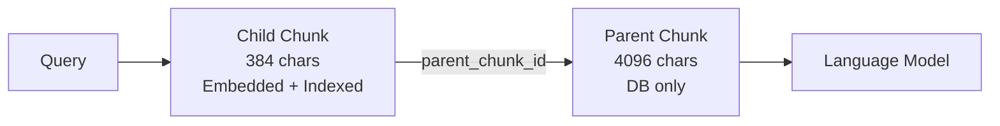

WeKnora's retrieval layer separates index storage from the fusion logic. Each configured backend provides independent vector and keyword search; a unified Reciprocal Rank Fusion (RRF) layer in the Go application combines results across backends and across knowledge bases. This architecture means you can use multiple backends simultaneously and the scoring remains consistent regardless of which engine produced each hit.

## Vector Database Options

<Tabs>
  <Tab title="PostgreSQL (default)">
    Uses `pgvector` (`halfvec` half-precision) with HNSW expression indexes for vector search, and ParadeDB `pg_search` BM25 (`|||` operator) for keyword search. Shares the application database—no extra infrastructure required.

    ```env
    RETRIEVE_DRIVER=postgres
    ```

    The HNSW index is built on the expression `(embedding::halfvec(dim)) halfvec_cosine_ops`. The `ORDER BY` clause in queries must match this expression exactly; otherwise pgvector falls back to a sequential scan.
  </Tab>
  <Tab title="SQLite">
    Fully embedded, zero external dependencies. Uses `sqlite-vec` (`vec0` virtual tables) for vector search and FTS5 with application-side bigram tokenization for keyword search. Recommended for desktop, development, or very small deployments.

    ```env
    RETRIEVE_DRIVER=sqlite
    ```
  </Tab>
  <Tab title="Elasticsearch v8">
    `script_score` with `cosineSimilarity` for vectors; `match` BM25 for keywords. Note: the Lucene engine rejects negative final scores, so the driver truncates raw cosine values to `max(cosineSimilarity, 0.0)`.

    ```env
    RETRIEVE_DRIVER=elasticsearch_v8
    ELASTICSEARCH_ADDR=http://es:9200
    ELASTICSEARCH_USERNAME=elastic
    ELASTICSEARCH_PASSWORD=changeme
    ```
  </Tab>
  <Tab title="OpenSearch">
    Native k-NN HNSW plugin for vectors; `match` BM25 for keywords. Requires `opensearch-knn` on all nodes and OpenSearch ≥ 2.11 or 3.x. The driver converts `COSINESIMIL` scores (range `(1+cos)/2`) back to cosine similarity for consistent cross-engine scoring.

    ```env
    RETRIEVE_DRIVER=opensearch
    OPENSEARCH_ADDR=http://opensearch:9200
    ```
  </Tab>
  <Tab title="Milvus">
    HNSW with configurable metric (IP / COSINE / L2) for vectors; native BM25 sparse-vector full-text search via the built-in BM25 Function (Milvus ≥ 2.5). Supports multilingual analysis (English, Chinese/Jieba, ICU default).

    ```env
    RETRIEVE_DRIVER=milvus
    MILVUS_ADDRESS=localhost:19530
    MILVUS_METRIC_TYPE=IP
    ```
  </Tab>
  <Tab title="Qdrant">
    Native HNSW Cosine for vectors; multi-language tokenizer full-text index with `MatchText` OR semantics for keywords (no BM25 score—keyword hits are ranked by RRF position only). Every embedding dimension gets its own collection.

    ```env
    RETRIEVE_DRIVER=qdrant
    QDRANT_HOST=localhost
    QDRANT_PORT=6334
    ```
  </Tab>
  <Tab title="Others">
    **Weaviate** — GraphQL `nearVector` (certainty-based) + native BM25. Supports replica and shard configuration.

    **Apache Doris** — ANN HNSW `inner_product` + inverted index `MATCH_ANY` with Chinese parser. Each embedding dimension gets its own table.

    **Tencent VectorDB** — Cloud-hosted; HNSW COSINE + sparse SPARSE_INVERTED BM25. Zero operational overhead.

    **Elasticsearch v7** — Keyword-only (`Support()` returns `[keywords]` only). Pair with another vector-capable driver.

    ```env
    # Multiple drivers can be combined with commas:
    RETRIEVE_DRIVER=postgres,elasticsearch_v7
    ```
  </Tab>
</Tabs>

## Hybrid Search Architecture

Every driver provides independent vector and keyword search. WeKnora's hybrid search always combines these at the application layer using RRF—not the engine's own hybrid pipeline:

```text
Query
  ├── Embedding model → vector search (cosine similarity)
  └── Keyword tokenizer → BM25 keyword search
          ↓
    RRF fusion (per-list ranking, normalized to [0,1])
          ↓
    Cross-encoder reranker (optional)
          ↓
    MMR diversity filter
          ↓
    Final results
```

### RRF Scoring

```go
rrf   = vectorWeight/(rrfK + vectorRank) + keywordWeight/(rrfK + keywordRank)
score = rrf / ((vectorWeight + keywordWeight) / (rrfK + 1))  // normalized to [0,1]
```

Default weights: `vectorWeight = 0.7`, `keywordWeight = 0.3`, `rrfK = 60`. These are configurable per tenant via `RetrievalConfig`.

### Cross-Engine Score Normalization

All vector scores are normalized to cosine similarity before fusion regardless of the engine's native score range:

| Engine | Native Score | Driver Conversion |
| --- | --- | --- |
| PostgreSQL / SQLite | cosine distance | `1 - distance` |
| Qdrant / TencentVectorDB / Doris | cosine (or normalized inner product) | pass-through |
| Milvus (IP / COSINE) | inner product / cosine | pass-through |
| Milvus (L2) | squared Euclidean distance | `1 - d/2` |
| OpenSearch | `COSINESIMIL = (1+cos)/2` | `2 * score - 1` |
| Weaviate | certainty `= (1+cos)/2` | `2 * certainty - 1` |

BM25 scores are **not** normalized at this stage—they have no upper bound, and compressing them would flatten the long tail. They are handled by RRF rank position instead.

## Reranking

After RRF fusion, an optional cross-encoder reranker re-scores the top candidates. The rerank scoring input for each chunk is: document title + chunk content. FAQ chunks are excluded from reranking.

The composite final score used in the chat pipeline is:

```text
0.6 × rerank_score + 0.3 × retrieval_base_score + 0.1 × source_weight
```

followed by MMR (λ = 0.7) for diversity and FAQ / Wiki weighting.

Supported rerank model vendors include any OpenAI-compatible rerank endpoint. Configure `rerank_model_id` in the knowledge base or agent settings.

## Parent-Child Chunking

Parent-child chunking is a retrieval strategy designed to provide precise matching with rich context. It is configured per knowledge base:

| Config | Default | Description |
| --- | --- | --- |
| `enable_parent_child` | `false` | Enable two-level chunking |
| `parent_chunk_size` | `4096` | Parent chunk size in characters (stored, not indexed) |
| `child_chunk_size` | `384` | Child chunk size (embedded and indexed) |

During retrieval, **child chunks are matched** by the vector and keyword index. When a child chunk is returned, the Go application fetches its parent chunk from the database and provides the full parent content to the language model. This gives the model broader context without widening the matching window.



## GraphRAG via Neo4j

When `graph_enabled` is set in a knowledge base's indexing strategy, WeKnora extracts entities and relationships into a Neo4j graph. During chat, the agent pipeline includes an `ENTITY_SEARCH` stage that queries this graph for entities mentioned in the query, expands to their neighbors, and injects the resulting sub-graph as additional context.

```env
NEO4J_ENABLE=true
NEO4J_URI=bolt://neo4j:7687
NEO4J_USERNAME=neo4j
NEO4J_PASSWORD=changeme
```

A single query expands at most 200 seed entities and returns at most 2,000 rows. The agent tool `query_knowledge_graph` exposes this capability directly.

## Hybrid Search API Endpoint

The hybrid search endpoint is available both for internal agent use and for direct API calls:

```http
POST /api/v1/knowledge-bases/:id/hybrid-search
```

### Key Parameters

| Parameter | Type | Description |
| --- | --- | --- |
| `query` | string | The natural-language query to search for |
| `top_k` | int | Number of results to return (default: 10, max: 30) |
| `mode` | string | `hybrid` (default), `semantic`, or `keyword` |
| `vector_threshold` | float | Minimum cosine similarity score (e.g., `0.5`) |
| `keyword_threshold` | float | Minimum keyword score (e.g., `0.3`) |
| `knowledge_base_ids` | []string | List of KB IDs to search (for multi-KB search) |
| `rerank` | bool | Whether to apply cross-encoder reranking |
| `rerank_top_k` | int | Number of results to keep after reranking |

### Example Request

```json
{
  "query": "What is the refund policy for enterprise subscriptions?",
  "top_k": 10,
  "mode": "hybrid",
  "vector_threshold": 0.5,
  "rerank": true,
  "rerank_top_k": 5
}
```

## Retrieval Evaluation

WeKnora includes a retrieval evaluation framework accessible in the knowledge base settings. You can test retrieval quality using metrics including:

- **Recall@K**: Proportion of relevant documents in the top-K results
- **BLEU / ROUGE**: Text overlap metrics for generated answer quality

Use the chunker preview endpoint (`POST /api/v1/chunker/preview`) to test chunking settings without writing to the database before committing to a configuration.

## Engine Configuration Reference

| Variable | Default | Description |
| --- | --- | --- |
| `RETRIEVE_DRIVER` | `postgres` | Comma-separated list of active drivers: `postgres`, `sqlite`, `elasticsearch_v7`, `elasticsearch_v8`, `opensearch`, `qdrant`, `milvus`, `weaviate`, `doris`, `tencent_vectordb` |
| `MULTI_STORE_RETRIEVE_TIMEOUT_SEC` | `30` | Per-store-group timeout for parallel multi-store retrieval |
| `ELASTICSEARCH_ADDR` / `ELASTICSEARCH_USERNAME` / `ELASTICSEARCH_PASSWORD` | — | Elasticsearch v7 / v8 endpoint and credentials |
| `OPENSEARCH_ADDR` / `OPENSEARCH_USERNAME` / `OPENSEARCH_PASSWORD` | — | OpenSearch endpoint and credentials (version ≥ 2.11 or 3.x) |
| `QDRANT_HOST` / `QDRANT_PORT` | `localhost` / `6334` | Qdrant gRPC endpoint |
| `QDRANT_API_KEY` / `QDRANT_USE_TLS` | — / `false` | Qdrant authentication and TLS |
| `MILVUS_ADDRESS` | `localhost:19530` | Milvus gRPC endpoint |
| `MILVUS_METRIC_TYPE` | `IP` | Metric type (`IP`, `COSINE`, or `L2`)—changing this requires rebuilding collections |
| `WEAVIATE_HOST` / `WEAVIATE_GRPC_ADDRESS` | `weaviate:8080` / `weaviate:50051` | Weaviate HTTP and gRPC endpoints |
| `DORIS_ADDR` / `DORIS_HTTP_PORT` | `doris-fe:9030` / `8030` | Doris FE and HTTP (Stream Load) endpoints |
| `TENCENT_VECTORDB_ADDR` / `TENCENT_VECTORDB_USERNAME` / `TENCENT_VECTORDB_API_KEY` | — | Tencent VectorDB endpoint and credentials (all three required) |
| `NEO4J_ENABLE` | `false` | Enable graph retrieval via Neo4j |
| `NEO4J_URI` / `NEO4J_USERNAME` / `NEO4J_PASSWORD` | `bolt://neo4j:7687` / `neo4j` / — | Neo4j connection details |

<Note>
A knowledge base's `VectorStoreID` binding cannot be changed after creation. When registering a new `VectorStore` instance via the admin API, existing knowledge bases continue using their original store. Use `move` with `reparse` mode to migrate content to a new store.
</Note>
