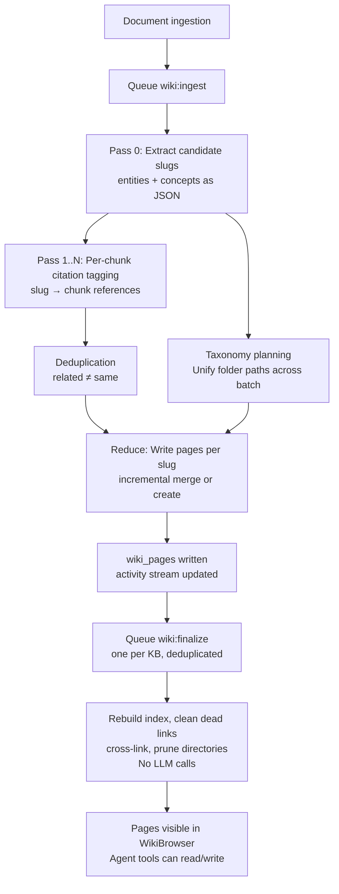

The Wiki feature transforms a collection of documents into a structured, browsable encyclopedia. When you enable the Wiki index on a knowledge base, an agent-driven pipeline reads each document, extracts named entities and concepts, and generates interlinked Markdown pages organized by type. Subsequent document uploads and re-parses incrementally update the wiki—you never need to manually trigger a rebuild.

Users can edit any generated page directly in the browser, view a full revision history that distinguishes pipeline-written, agent-written, human-written, and rollback versions, and revert to any past state. The same pages are also accessible to agents via nine dedicated wiki tools, enabling automated research and maintenance workflows.

## Enabling Wiki on a Knowledge Base

<Steps>
  <Step title="Open KB Settings">
    Navigate to the knowledge base and open **Settings** (the gear icon).
  </Step>
  <Step title="Enable the Wiki index">
    In the **Indexing Strategy** tab, toggle the **Wiki** switch on. WeKnora automatically creates an empty `WikiConfig` for the knowledge base.
  </Step>
  <Step title="Configure extraction granularity and model">
    Choose an extraction granularity and select a synthesis model under **Wiki Config**. If no model is set, the knowledge base's default summary model is used.
  </Step>
  <Step title="Wait for generation">
    Wiki generation is asynchronous. As documents finish parsing, the pipeline queues `wiki:ingest` tasks. An "Indexing" indicator appears in the knowledge base breadcrumb while generation is in progress.
  </Step>
  <Step title="Browse the wiki">
    Click the **Wiki** tab in the knowledge base view to browse generated pages. The **Graph** tab shows the entity relationship graph.
  </Step>
</Steps>

<Note>
Wiki generation increases model call usage. The extraction granularity setting controls how many entities and concepts are extracted per document:
- `focused`: 3–7 major topics only
- `standard` (default): major topics plus entities substantively discussed (a paragraph, multiple points, or 2–3 sentences)
- `exhaustive`: every named entity and recognized concept
</Note>

## How Wiki Generation Works

The generation pipeline follows a four-stage Map-Reduce structure triggered by document ingestion:

**Pass 0** extracts a skeleton of entity and concept slugs from each document. **Pass 1–N** tags each chunk with citations for those slugs—leveraging prefix caching to reduce model costs on long documents. The **Reduce** phase merges new citations into existing pages or creates new ones, enforcing strict grounding rules (no hallucinated content). The **Finalize** phase rebuilds the index page, cleans dead links, and adds cross-links using only SQL and graph algorithms—no LLM calls.

### Slug Format

Every wiki page has a slug that identifies it within its knowledge base:

- **Format**: `<type>/<name>`, e.g., `entity/acme-corp`, `concept/rag`, `summary/<knowledge-uuid>`
- **Uniqueness**: Per knowledge base (the same slug can exist in different KBs)
- **Stability**: When a document is re-parsed, the pipeline reuses existing slugs for the same entities—new slugs are only generated for genuinely new entities

## Browsing the Wiki

The **WikiBrowser** provides two views:

<CardGroup cols={2}>
  <Card title="Directory Tree + Page View" icon="sitemap">
    A left-side folder tree organizes pages by type (entity, concept, summary, synthesis, comparison). Clicking a page shows its full Markdown content, metadata, outbound links, and source document references.
  </Card>
  <Card title="Knowledge Graph" icon="circle-nodes">
    A node-link graph visualization where nodes are wiki pages colored by type. Click any node to jump to that page. The graph supports both global overview and ego-network (single-node neighborhood) modes.
  </Card>
</CardGroup>

## Page Types

| Type | Description |
| --- | --- |
| `entity` | People, organizations, products, technologies, and other named entities |
| `concept` | Themes, methodologies, and abstract ideas discussed in the documents |
| `summary` | One page per source document (slug: `summary/<knowledge-uuid>`) |
| `index` | Auto-generated wiki-level index page (metadata only) |
| `synthesis` | Cross-source analysis pages—**only createable by agents** via `wiki_write_page` |
| `comparison` | Comparative analysis pages—**only createable by agents** via `wiki_write_page` |

## In-Browser Page Editing

Any page can be edited directly in the WikiBrowser. The editor supports full Markdown with a preview mode. After saving, the revision is indexed and the updated page becomes immediately searchable and agent-accessible.

<Warning>
The edit history distinguishes four sources: `pipeline` (auto-generated), `agent` (written by an agent tool), `user` (human edit), and `revert` (rollback). Histories are preserved so you can always see who made a change and why.
</Warning>

## Revision History and Rollback

Every time a page is overwritten, the previous version is snapshotted into `wiki_page_revisions` before the new content is written. The current version always lives in `wiki_pages`.

**Retention policy**:
- **Soft limit (50 versions)**: Prunes only auto-generated (`pipeline`) versions
- **Hard limit (200 versions)**: Prunes all versions regardless of source

Human-edited versions are always retained preferentially until the hard limit is reached.

To roll back a page, use the version history panel:
1. Click **History** on any wiki page
2. Browse versions by source, editor, and timestamp; compare diffs between any two versions
3. Click **Revert** on the desired version—this creates a **new** version with the old content; the version counter continues incrementing

<Note>
"Reverts of reverts" are fully supported since rollback itself creates a new version with `edit_source = revert`. There is no concept of destructive undo.
</Note>

## Wiki API Endpoints

All wiki routes are under `/api/v1/knowledgebase/:kb_id/wiki`. There is no anonymous access—all endpoints require authentication and respect RBAC.

### Read Endpoints (Viewer + KBAccessRead)

| Method | Path | Description |
| --- | --- | --- |
| GET | `/pages` | List all pages (with pagination and filters) |
| GET | `/pages/*slug` | Fetch a single page by slug |
| GET | `/folders` | Get the folder tree |
| GET | `/index` | Get the wiki index page |
| GET | `/graph` | Knowledge graph (global or ego-network mode) |
| GET | `/search?q=...` | Full-text search across titles, aliases, summaries, and content |
| GET | `/revisions/*slug` | List revision history; `?version=N` retrieves a specific version's full content |
| GET | `/stats` | Page and link statistics |
| GET | `/issues` | List open quality issues flagged by agents or users |

### Write Endpoints (OwnedWikiKBOrAdmin + KBAccessWrite)

| Method | Path | Description |
| --- | --- | --- |
| POST / PUT / DELETE | `/pages`, `/pages/*slug` | Create, update, or delete pages |
| POST / PUT / DELETE | `/folders`, `/folders/:folder_id` | Manage the folder tree |
| PUT | `/move-page` | Move a page to a different folder |
| POST | `/revert` | Rollback: `{ "slug": "entity/foo", "version": 12 }` |
| POST | `/rebuild-links` | Rebuild the link graph |
| PUT | `/issues/:issue_id/status` | Update an issue's status (`pending`, `resolved`, `ignored`) |

## Wiki Agents

Two built-in agents work with wikis:

<CardGroup cols={2}>
  <Card title="Wiki Researcher" icon="magnifying-glass">
    Read-only agent for browsing and researching wiki content. Uses `wiki_search` → `wiki_read_page` → `read_document` for sourced answers. Can flag issues with `wiki_flag_issue`.
  </Card>
  <Card title="Wiki Editor (Fixer)" icon="pen-to-square">
    Full read-write agent with all 9 wiki tools. Designed for automated maintenance: fixing dead links, merging duplicate entities, updating outdated facts, and closing flagged issues.
  </Card>
</CardGroup>

### Wiki Tool Reference

| Tool | Key Parameters | Action |
| --- | --- | --- |
| `wiki_search` | `query` (POSIX regex or literal), `knowledge_base_ids`, `limit` | Search across titles, aliases, summaries, and content |
| `wiki_read_page` | `slugs: string[]` | Fetch full page content, metadata, and in/out links |
| `wiki_write_page` | `slug`, `title`, `summary`, `content`, `page_type` | Create or overwrite a page; only way to create `synthesis` or `comparison` pages |
| `wiki_replace_text` | `slug`, `old_text`, `new_text` | Precise in-page text replacement for small edits |
| `wiki_rename_page` | `slug`, `new_slug` | Rename slug and auto-update all backlinks |
| `wiki_delete_page` | `slug` | Delete page and clean up dead links in other pages |
| `wiki_flag_issue` | `slug`, `issue_type`, `description` | Report factual errors, entity confusion, or outdated information |
| `wiki_read_issue` | `issue_id` or `slug` | View issue details or list pending issues for a page |
| `wiki_update_issue` | `issue_id`, `status` | Resolve or dismiss a flagged issue |

## Failure Recovery

WeKnora recovers pending wiki tasks automatically on service restart by scanning the `task_pending_ops` table for `wiki:ingest` and `wiki:finalize` entries with active knowledge bases and re-queuing them. Additional runtime protections include:

- **Wiki disabled or model deleted**: Clears pending ingest operations and releases documents from the "indexing" state so they don't appear stuck
- **Transient errors**: Model calls with 408/429/5xx responses or rate limit errors retry with exponential backoff
- **Failure priority**: Documents with fewer failures are processed first—repeatedly failing documents don't block new ones
